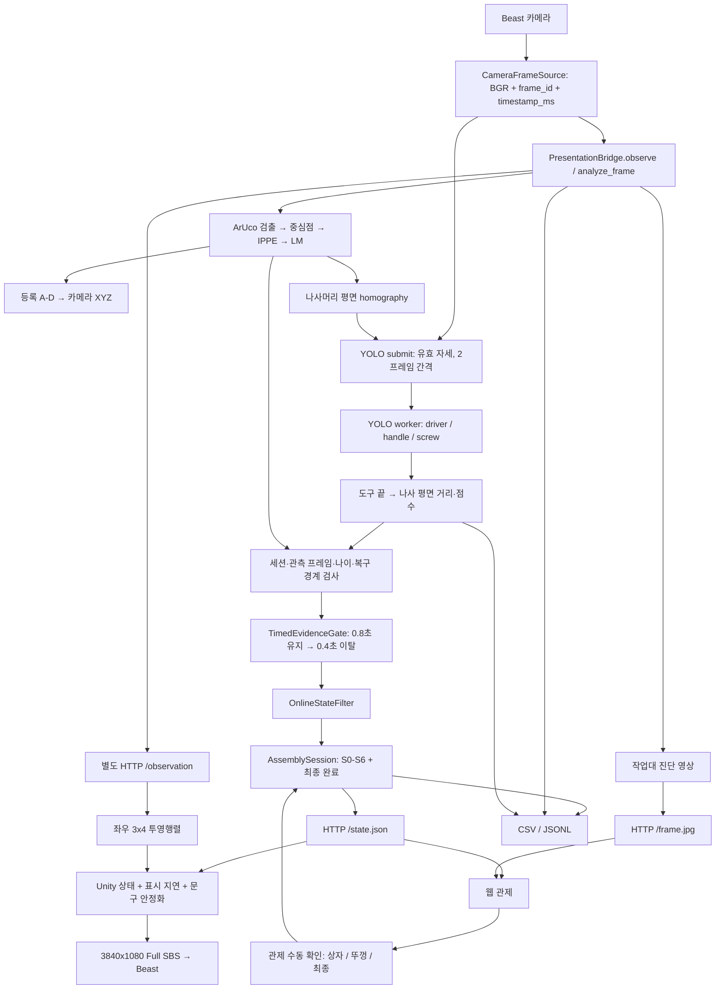

# AI Assembly Guide: 현재 프로젝트 파이프라인 상세 해설

작성 기준: 2026-11-14. 실제 코드, 마지막 통합 실행 설정, 저장 로그를 기준으로 작성했다.

이 문서는 홍보용 설명이나 향후 설계안이 아니라 **현재 무엇이 어떤 조건으로 실행되는지 확인하기 위한 코드 해설서**다. 기존 성공본, 보정값, 실행 코드는 변경하지 않았다. 문서 작성 중 카메라와 Unity를 새로 실행하지 않았다.

## 목차

1. [현재 시스템의 핵심 결론](#pipeline-01)
2. [문서 기준 실행본과 파일](#pipeline-02)
3. [실행 환경과 프로세스 경계](#pipeline-03)
4. [전체 데이터 흐름](#pipeline-04)
5. [실행 준비와 종료](#pipeline-05)
6. [카메라 입력과 시간 기준](#pipeline-06)
7. [ArUco, PnP, A-D 좌표](#pipeline-07)
8. [YOLO와 도구-나사 근접 특징](#pipeline-08)
9. [조립 단계와 시간 증거 상태머신](#pipeline-09)
10. [추적 단절, 진행 보존, 재확인](#pipeline-10)
11. [HTTP 계약과 데이터 예시](#pipeline-11)
12. [Unity 양안 오버레이와 표시 지연](#pipeline-12)
13. [웹 관제](#pipeline-13)
14. [양안 보정 수집과 오프라인 모델 계산](#pipeline-14)
15. [MediaPipe, HMM, Viterbi의 별도 분석 경로](#pipeline-15)
16. [로그, 재현, 마지막 통합 시험](#pipeline-16)
17. [현재 구현 범위와 개선 지점](#pipeline-17)
18. [코드 탐색 지도와 재현 방법](#pipeline-18)

---

<a id="pipeline-01"></a>

## 1. 현재 시스템의 핵심 결론

실시간 시연은 다음 흐름이다.

> Beast 카메라 영상 → ArUco 기반 카메라 자세 추정 → 등록된 나사 A-D 위치 계산 → YOLO로 드라이버 위치 검출 → 도구 끝의 나사 근접/유지/이탈 증거 판정 → FSM 단계 전환 → Unity 양안 원과 문구 + 브라우저 관제.

중요한 사실은 다음과 같다.

- 현재 실행 모드는 **hybrid**다. 상자 배치와 뚜껑 닫힘은 사람이 확인하고, 나사 A-D는 도구 접근/유지/이탈로 자동 진행하며, 마지막 완료도 사람이 확인한다.
- 실시간 단계 진행의 핵심은 `OnlineStateFilter`와 `TimedEvidenceGate`다. **현재 live 루프에는 HMM/Viterbi와 MediaPipe가 연결되어 있지 않다.**
- YOLO는 `driver`, `handle`, `screw`를 검출한다. 현재 metric 모드에서 단계 판정은 주로 **등록된 나사 위치와 추정 도구 끝의 거리**를 쓴다.
- “나사가 실제로 조여졌다”를 직접 검증하는 토크/회전량 센서는 없다. `OBSERVED`는 도구 상호작용 증거가 확보됐다는 뜻이다.
- Unity는 카메라 영상을 안경에 덮는 것이 아니라 **검정 바탕에 눈별 목표 원과 안내 문구를 그려 Full SBS로 출력**한다. 실제 작업대는 안경을 통해 직접 보게 된다.
- 최신 통합 시험은 A-D 공통 양안 후보를 사용했다. 예전 A +17px 오프셋과 예전 C/D 거리 보정을 중첩하지 않았다.
- 한 번 완료된 A-D 단계가 추적 단절 때문에 S0으로 되돌아가는 구조는 아니다. 주로 **현재 나사의 HOLD 증거가 만료되어 다시 확보하는 것**이 “초기화되는 느낌”을 만든다.
- 소프트웨어 시험 통과, 동일 착용에서의 사용자 정합 확인, 임의 착용/각도의 일반적인 정합 성능은 서로 다른 검증이다.

<a id="pipeline-02"></a>

## 2. 문서 기준 실행본과 파일

### 2.1 프로젝트 위치

프로젝트 루트:

```text
C:/Users/fresh/OneDrive/Desktop/홍익대/4학년/2학기/vision/01_SUBMIT_KEEP/AR-assembly-psr_github_main_20260604/.worktrees/viture-beast-overlay-mvp
```

문서의 소스 링크는 이 루트 안의 실제 파일로 연결된다. 별도 분석·시험 산출물은 다음 폴더에 있다.

[2026-11-14 분석 및 시험 폴더](C:/Users/fresh/Documents/Codex/beast-reference-return-20261114)

### 2.2 기존 성공본과 최신 시험본의 차이

| 항목 | 보존된 기존 성공본 경로 | 마지막 통합 시험 |
|---|---|---|
| 실행 진입 | `scripts/start_beast_assembly.ps1` | `start-joint-assembly-trial.ps1` |
| Unity 출력 폴더 | `outputs/unity_p1` | 분석 폴더의 `poll-candidate-build` |
| 양안 투영 | 기존 candidate-probe | `candidate-ABCD-joint-unverified.json` |
| A 화면 이동 | 기존 런처의 A +17px 시험 옵션 | 사용 안 함 |
| C/D 별도 거리 보정 | `beast_stage_depth_records.json` | 사용 안 함 |
| 상자/뚜껑/최종 | 수동 확인 | 수동 확인 |
| 나사 단계 | timed FSM | timed FSM |
| 근접 증거 | 800ms | 800ms |
| 이탈 증거 | 400ms | 400ms |
| 중간 HOLD 복구 예산 | 600ms | 600ms |
| 완료 HOLD 복구 예산 | 2000ms | 2000ms |
| source recovery boundary | 별도 옵션, 기본 꺼짐 | 켜짐 |
| 초록 안내 지연 | 기본 0ms, 별도 옵션 | 2000ms, Unity 표시만 지연 |

“기존 성공본”은 보존된 시작 경로를 뜻하며, 이 표의 기본값만으로 모든 과거 시험 설정이 같았다는 뜻은 아니다.

핵심 파일:
- [기존 시작 스크립트][launcher-old]
- [최신 시험 래퍼][launcher-new]
- [공통 실행·정리 스크립트][launcher]
- [최신 공통 양안 후보][candidate]
- [마지막 통합 시험 보고서][trial-report]
- [마지막 실행의 유효 설정][config-used]

### 2.3 마지막 시험의 식별 정보

```text
session_id:
viture_aruco_rt_20261114_214414_1b5738df444c

guidance_mode: hybrid
source: camera 0, DirectShow, requested 1280x720
display: VITURE Beast, 3840x1080, Full SBS
wearing/display conditions: 0DoF, Extra Large, 4.5m

candidate SHA256:
1127d29fb5022d005373d12eb0a8886fabafa53c852ac4bb3fd281ccd10904f3

trial Assembly-CSharp.dll SHA256:
61eb05ba62d69feb344743371a5bccef03881c2e8188522dfe6cd28014d5938a

camera profile SHA256:
25f025bc5c2f71e4c83e6645e5cdc742bda81cd75d30c55ff7e5aca99924872e

workspace profile SHA256:
5d4f4c6610af3264e0583eb64b038b3d66b12a9fc4844849d21d4f770d5c7acc
```

현재 시험은 **202mm 후보 작업대 프로필이 아니라, 기존 205mm 간격이 포함된 작업대 프로필에 묶인 공통 양안 후보**다. 202mm 후보와 현재 값을 혼용하면 안 된다.

후보 JSON에는 `candidate_only=true`, `calibration_valid=false`, `display_alignment_verified=false`가 남아 있다. 이후 동일 착용 실기 확인은 별도 보고서에 기록했으며, 해당 JSON의 `live_validation="pending"` 문자열이나 기존 성공본을 자동 갱신하지 않았다.

<a id="pipeline-03"></a>

## 3. 실행 환경과 프로세스 경계

| 경계 | 실제 구성 | 역할 |
|---|---|---|
| 물리 작업대 | 커팅매트, 고정 ArUco 마커, 상자·뚜껑, A-D 나사, 드라이버 | 기준 좌표와 작업 대상 |
| Beast 카메라 | Windows 카메라 장치 | 작업자 시점 BGR 영상 입력 |
| 실행 관리자 | PowerShell | 사전 검사, Python/Unity 실행, 제한 시간, 종료 정리 |
| Python 서버 프로세스 | Python, OpenCV, NumPy, Ultralytics, YAML 등 | 영상 분석, 단계 판정, 상태 및 관측 HTTP 제공 |
| Python 내부 YOLO 스레드 | `RealtimeYoloAnalyzer` | 최신 대기 프레임을 추론 |
| Python 내부 HTTP 스레드 | `ThreadingHTTPServer` | 상태/JPEG, 별도 관측 API 응답 |
| Unity Player | C#, Unity | 상태·관측 수신, 눈별 투영, Full SBS 렌더 |
| 브라우저 | Chrome, HTML/CSS/JavaScript | 영상·작업 진행·보류 이유 표시, 수동 확인 요청 |
| 오프라인 분석 | 별도 실행 Python 스크립트 | 보정 계산, 저장 로그 재현, MediaPipe/HMM 실험 |

현재 실시간 파이프라인은 클라우드 서버, WebSocket 메시지 버스, ROS 또는 공유 메모리 IPC로 연결된 구조가 아니다. **동일 Windows 노트북에서 loopback HTTP와 로컬 설정 파일을 사용한다.**

Beast의 제조사 SDK, IMU, Neckband의 marker anchor API가 현재 나사 위치를 생성하는 호출 경로에도 들어 있지 않다. 현재 좌표 추적은 OpenCV의 카메라 영상과 등록 마커 기하에서 나온다.

<a id="pipeline-04"></a>

## 4. 전체 데이터 흐름



이 도식에 없는 MediaPipe → HMM/Viterbi 경로는 15장에서 별도로 설명한다. 현재 자동 단계 전환 화살표를 HMM에서 시작하도록 그리면 실제 코드와 다르다.

<a id="pipeline-05"></a>

## 5. 실행 준비와 종료

### 5.1 진입 순서

1. 최신 시험 래퍼가 보호된 파일 9개의 SHA256과 시험 DLL 해시를 검사한다.
2. `run_beast_demo.ps1`에 후보, Unity 폴더, `AssemblyFlow`, 복구 옵션, 표시 지연을 전달한다.
3. Python의 `--doctor` 경로로 의존성, 모델과 프로필 등 실행 조건을 검사한다.
4. `CheckOnly`이면 여기서 종료한다. 카메라/Unity는 시작하지 않는다.
5. 실제 실행이면 자체 로그 폴더와 stop 파일 경로를 만든다.
6. Python 서버를 숨김 창으로 실행한다. 기본 상태 서버 주소는 `127.0.0.1:8765`다. 포트가 이미 사용 중이면 다른 사용 가능 포트를 고른다.
7. 자기 세션의 새로운 상태가 오는지 확인한다. 다른 서버의 오래된 상태를 그대로 채택하지 않는다.
8. Python이 만든 `client-config.json`으로 관측 API 주소, 세션, 프로필 식별자를 Unity에 연결한다.
9. Beast 디스플레이를 선택하고 Full SBS Unity를 실행한다.
10. 실제 상태 서버의 `/supervisor.html`을 연다.
11. 제한 시간, 서버 종료 또는 Unity 종료를 감시하고, 끝나면 자신이 실행한 프로세스만 정리한다.

마지막 시험의 래퍼 옵션은 실제 코드에서 다음과 같다.

```powershell
$options = @{
    Python = $Python
    PresentationConfig = Join-Path $ProjectRoot 'outputs/demo/presentation.json'
    CandidateProjection = $candidate
    UnityOutputDirectory = $unityOutput
    AssemblyFlow = $true
    NestedDriverDedup = $true
    SourceRecoveryBoundary = $true
    ObservedCueDelayMs = 2000
    ScrewResumeMs = 600
    CompletedHoldResumeMs = 2000
    DurationSeconds = $DurationSeconds
    CameraIndex = 0
    CheckOnly = !$Live
}
```

이 래퍼는 예전 `TrialARight` 또는 `StageDepthConfig`를 전달하지 않는다.

### 5.2 유효 설정에서 주의할 점

[기본 설정][runtime-config]과 [실행 시 override 코드][main-loop]를 함께 확인해야 한다. hybrid 모드는 오래된 경로 일부를 명시적으로 끈다.

- `aruco.enabled=false`: **구형 ArUcoRealtimeTracker 경로가 꺼진 것**이다. metric `PresentationBridge` 안의 ArUco/PnP는 여전히 실행된다.
- `roi.enabled=false`: 상자·뚜껑의 ROI 자동 판정을 현재 통합 시연에서 사용하지 않는다.
- `state_filter.initial_state=S2`: 내부 나사 필터의 시작 상태다. 외부 `AssemblySession`은 S0부터 시작한다.
- YAML에 ROI 임계값, frame 기반 dwell 값이 남아 있어도 현재 timed/hybrid 분기에서 전부 사용되는 것은 아니다.
- 원래 YOLO 거리 설정이 `110/50`이어도 metric 모드 생성자에서 실제로 `12mm/4mm`로 덮어쓴다.

### 5.3 종료

최신 래퍼의 최대 설정은 300초다. 실행 관리자의 시간 제한에는 준비·시작 시간이 포함될 수 있다. 개별 정합 진단의 L/R 화면과 Space 시작 절차는 별도 진단 모드이며, 통합 S0-S6 실행의 필수 절차가 아니다.

종료 시 Unity를 끝내고 stop 파일로 Python 루프의 종료를 요청한다. 필요할 때만 자신이 소유한 프로세스 트리를 종료한다. 진행 상태는 현재 Python 세션의 메모리에 있으며, **서버를 재시작했을 때 이전 작업을 자동 복원하는 영속 checkpoint는 현재 구현되어 있지 않다.**

<a id="pipeline-06"></a>

## 6. 카메라 입력과 시간 기준

소스: [CameraFrameSource][camera-source], [FramePacket 및 메시지 구조][schemas].

```python
ok, frame = self.cap.read()
if not ok or frame is None:
    time.sleep(0.02)
    continue
frame_id += 1
yield FramePacket(
    frame_id=frame_id,
    timestamp_ms=int(time.perf_counter() * 1000),
    source="camera",
    frame=frame,
)
```

### 6.1 입력 계약

| 값 | 의미 |
|---|---|
| `frame` | OpenCV BGR NumPy 이미지 |
| `frame_id` | 이 서버 실행 안에서 증가하는 프레임 번호 |
| `timestamp_ms` | `cap.read()` 성공 직후의 단조 시계 값 |
| `source` | `camera`, `session`, `dummy` 중 하나 |
| `source_frame_id` | 저장 이미지 재생 모드에서만 원본 프레임 ID 보조 기록 |

타임스탬프는 **센서 노출 시작 시각이 아니다.** 드라이버 내부 버퍼 지연까지 측정한 timestamp로 해석하면 안 된다. 카메라 루프는 별도 capture queue 스레드가 아니라 메인 처리 루프가 iterator에서 다음 영상을 읽는 구조다. YOLO만 별도 worker에서 실행된다.

1280×720은 요청 해상도다. metric 분석은 실제 이미지 크기가 카메라 보정의 크기와 다르면 거부한다. 이 코드의 카메라 생성자에서는 FPS/FourCC를 명시적으로 고정하지 않는다. 마지막 처리 로그의 프레임 간격은 대략 100ms였지만, 이것을 30fps 카메라 출력 또는 고정 10fps 보장이라고 표현하면 안 된다.

### 6.2 서로 다른 시계와 나이

- Python 내부는 `time.perf_counter()`를 공통으로 쓴다.
- YOLO 결과 timestamp는 **추론 완료 시각이 아니라 입력 원본 프레임 timestamp**다.
- Unity는 자체 `Time.realtimeSinceStartupAsDouble`을 사용한다.
- Unity는 Python 절대 시각에서 자신의 시각을 빼지 않는다. 서버가 준 age에 HTTP 왕복시간 전체를 더해 보수적인 나이를 계산한다.
- 같은 프레임을 HTTP로 여러 번 받았다고 관측이 새로워지거나 HOLD 시간이 추가되는 것은 아니다.

### 6.3 메인 처리 루프

[실제 루프][main-loop]의 핵심 호출 순서를 줄이면 다음과 같다. 아래는 이해를 위한 축약이며 부가 진단·예외 처리는 생략했다.

```python
for packet in frame_source:
    observation = presentation.observe(packet)
    marker = metric_marker(observation, time.perf_counter())
    marker.homography = metric_plane.homography(observation, time.perf_counter())
    marker.marker_ok &= marker.homography is not None

    roi_result = roi_analyzer.process(packet.frame, marker.homography)

    if not marker.marker_ok:
        min_valid_yolo_frame = packet.frame_id + 1

    yolo.submit(packet.frame_id, packet.frame, marker.homography,
                timestamp_ms=packet.timestamp_ms, marker_ok=marker.marker_ok)
    yolo_result = yolo.get_result(
        packet.frame_id,
        now_ms=int(time.perf_counter() * 1000),
        min_valid_frame_id=min_valid_yolo_frame,
    )

    filter_input = make_filter_input(packet, marker, roi_result, yolo_result, features)
    estimate = operator.update(filter_input, fresh_input)
    presentation_frame, presentation_status = presentation.update(
        packet, target_id=guided_target(estimate, marker.marker_ok),
        observation=observation,
    )
    # 결과 JSONL, 상태 JSON, 진단 JPEG, latency 기록
```

<a id="pipeline-07"></a>

## 7. ArUco, PnP, A-D 좌표

### 7.1 프로필은 세 종류다

1. **카메라 보정:** 이미지 크기, 카메라 내참수 K, 렌즈 왜곡 계수.
2. **작업대 등록:** 마커의 작업대 좌표, 나사 A-D의 작업대 좌표.
3. **눈별 표시 보정:** 카메라 XYZ를 좌우 안경 화면 픽셀로 변환하는 투영행렬.

마커를 잘 검출한다고 3번까지 자동 해결되는 것은 아니다. 작업대에서의 나사 위치를 알아내는 문제와, 그 점을 실제 눈에 맞게 표시하는 문제는 분리되어 있다.

`load_profiles()`는 카메라 ID/해시와 작업대의 등록 출처를 검사한다. 양안 후보도 같은 카메라·작업대 ID와 SHA256에 묶여 있다. 숫자 몇 개만 다른 프로필로 바꾸고 눈 보정을 그대로 적용하도록 허용하지 않는다.

### 7.2 현재 작업대 좌표계

`MetricWorkspace.from_dict()`의 계약:

```text
units: mm
axes: x_right_y_away_z_up
origin_marker_id: 3
marker 3 center: [0, 0, 0]
mat plane: Z=0
target height: Z>=0
dictionary: DICT_4X4_50
```

현재 프로필의 마커 중심:

| ID | X mm | Y mm | Z mm |
|---|---:|---:|---:|
| 0 | 0 | 285 | 0 |
| 1 | 205 | 285 | 0 |
| 2 | 410 | 285 | 0 |
| 3 | 0 | 0 | 0 |
| 4 | 75 | 175 | 0 |
| 5 | 330 | 175 | 0 |

현재 등록된 목표점은 다음과 같다. 표는 읽기 위해 소수 셋째 자리로 반올림했으며 코드의 값은 반올림하지 않는다.

| 목표 | 작업자 기준 위치 | X mm | Y mm | Z mm |
|---|---|---:|---:|---:|
| A | 먼 왼쪽 | 148.737 | 155.701 | 60 |
| B | 먼 오른쪽 | 261.196 | 159.637 | 60 |
| C | 가까운 왼쪽 | 151.837 | 46.268 | 60 |
| D | 가까운 오른쪽 | 263.114 | 48.448 | 60 |

여기의 60mm는 **매트 평면에서 등록 목표점까지의 높이**다. 방 바닥 또는 책상 전체의 높이가 아니다. 현재 코드는 박스가 마커에 대해 고정되어 있다고 가정하므로, 박스만 움직이면 등록 좌표와 실제 나사가 달라진다.

### 7.3 영상에서 자세를 계산하는 순서

소스: [analyze_frame][analyze-frame], [workspace_projection][pose-code].

1. 입력 영상 크기가 보정 크기와 같은지 검사한다.
2. `detect_markers(..., corner_refinement='subpix')`로 검출한다.
3. 프로필에 등록된 ID만 사용한다. 같은 등록 ID가 중복되면 거부한다.
4. 마커별 네 모서리 픽셀을 숫자로 남긴다.
5. 모서리의 렌즈 왜곡을 보정한 뒤 중심점을 계산한다.
6. 보이는 등록 마커 중심이 최소 4개인지 검사한다.
7. 3D 중심점과 2D 중심점이 충분히 펼쳐졌는지 검사한다.
8. IPPE에 필요한 평면 제약의 rank를 검사한다.
9. `cv2.solvePnPGeneric(..., flags=cv2.SOLVEPNP_IPPE)`로 후보 자세를 계산한다.
10. 카메라가 매트 위에 있고 관측점들이 카메라 앞에 있는 물리적 후보만 남긴다.
11. 재투영 오차 순으로 고른다. 두 후보의 오차가 거의 같은데 자세가 다르면 모호한 자세로 거부한다.
12. `cv2.solvePnPRefineLM()`로 미세 조정한다.
13. RMS ≤3px, 최대 점 오차 ≤5px 조건을 통과해야 `tracking`으로 인정한다.

실제 핵심 호출:

```python
count, rotations, translations, _ = cv2.solvePnPGeneric(
    objects, observed, camera.matrix, None, flags=solver
)
rvec, tvec = cv2.solvePnPRefineLM(
    objects, observed, camera.matrix, None,
    best.rvec.copy(), best.tvec.copy()
)
if best.rms_px > max_rms_px or best.max_error_px > max_point_error_px:
    raise ValueError(...)
```

왜곡 보정된 관측점으로 PnP를 풀기 때문에 위 PnP의 distortion 인자는 `None`이다. 원본 영상에 A-D 픽셀을 다시 그릴 때에는 `projectPoints(..., camera.distortion)`를 사용한다.

### 7.4 “마커 4개인데도 안 된다”가 가능한 이유

개수만으로 판단하지 않는다. `require_ippe_support()`는 정규화된 평면 homography 설계행렬의 rank가 8보다 작으면 거부한다.

```python
if np.linalg.matrix_rank(design, tol=1e-10) < 8:
    raise ValueError(
        "Visible marker geometry is degenerate for IPPE; show a wider marker arrangement"
    )
```

현재 중심점에서 0,1,2는 한 줄이다. 이 세 개와 나머지 한 개만 보이는 조합은 해당 경로에서 `marker_geometry`로 거부될 수 있다. 따라서 “마커 하나만 가려도 무조건 실패”가 아니라 **남은 개수와 배치, 자세 해의 품질이 중요하다.**

별도 `estimate_corner_pose()`는 마커 네 모서리의 실측 3D 위치를 사용하는 **오프라인 후보 함수**다. 현재 실시간 중심점 기반 경로가 자동으로 그 함수로 전환되는 것은 아니다.

### 7.5 작업대 점을 카메라 점으로

```text
X_camera = R(rvec) * X_workspace + tvec
```

등록된 A-D는 작업대에서 고정되어 있지만, 머리/카메라가 움직이면 R과 t가 바뀌어 매 프레임 카메라 XYZ가 바뀐다. 그러므로 **머리를 정확히 같은 위치에 고정해야만 계산 가능한 구조는 아니다.** 단, 마커 자세와 눈별 보정이 유효해야 한다.

`project_targets()`는 카메라 영상에 그릴 픽셀을 만든다. `make_observation()`는 Unity가 쓸 `camera_targets`의 XYZ를 만든다. 둘은 용도가 다르다.

### 7.6 관측 유효성

`metric_marker()`는 `analysis.status == "tracking"`과 입력 나이 0~150ms를 요구한다. 별도 `/observation`에서도 나이, ID, 좌표, RMS, 최대 오차, 기준 목표의 가시성을 다시 검사한다.

Unity가 받을 때까지 오래 걸린 좌표는 폐기한다. 현재 통합 경로에 “마커가 사라져도 마지막 XYZ를 무기한 유지” 또는 IMU로 대체 추적하는 분기는 없다.

<a id="pipeline-08"></a>

## 8. YOLO와 도구-나사 근접 특징

소스: [RealtimeYoloAnalyzer][yolo-code].

### 8.1 모델과 입력

| 항목 | 마지막 실행값 |
|---|---|
| 가중치 | `models/yolo/driver_standard_model/best-3.pt` |
| API | `ultralytics.YOLO(...).predict()` |
| confidence cutoff | 0.2 |
| `imgsz` | 640 |
| 제출 간격 | 카메라 `frame_id % 2 == 0` |
| 처리 클래스 | `driver`, `handle`, `screw` |
| 추론 실행 | 같은 Python 프로세스의 백그라운드 스레드 |
| 기하 단위 | 현재 metric 모드에서는 mm |

호출부는 다음과 같다.

```python
pred = self.model.predict(
    source=frame_bgr, conf=self.conf, imgsz=self.imgsz, verbose=False
)[0]
```

현재 호출은 원본 BGR을 Ultralytics에 전달한다. `imgsz=640`은 내부 전처리 크기 설정이지 카메라가 640×640으로 바뀌었다는 뜻이 아니다. 이 호출에서 GPU 장치를 명시하지 않으므로, 장치 선택은 실제 런타임/Ultralytics 설정에 따른다.

### 8.2 제출과 worker

```python
if not marker_ok or timestamp_ms < 0 or homography is None or frame_id % self.interval_frames != 0:
    return
with self._pending_lock:
    self._pending = (
        int(frame_id), frame_bgr.copy(),
        np.array(homography, dtype=np.float64).copy(),
        int(timestamp_ms), bool(marker_ok),
    )
```

- 대기 슬롯 `_pending`은 하나다. 다음 프레임이 들어오면 아직 시작하지 않은 대기 작업을 최신 것으로 대체한다.
- 이미 실행 중인 추론을 취소하는 것은 아니다.
- worker는 작업을 가져와 `_pending=None`으로 만들고 추론한다.
- 결과에는 원본 프레임 ID, 원본 timestamp, 원본 marker 유효성을 붙인다.
- 따라서 “현재 카메라 프레임 N”에서 “조금 이전 프레임 M의 YOLO 결과”를 소비하는 것이 정상이다.

### 8.3 나사머리 평면으로 변환

`MetricToolPlane`은 A-D 높이가 거의 같은지 검사한다. 높이 차가 0.5mm보다 크면 현재 시험 모드에서 거부한다.

```text
h = mean(A.z, B.z, C.z, D.z)
plane = K * [R[:,0], R[:,1], t + R[:,2] * h]
H = shift * inverse(plane)
```

영상의 도구 끝을 먼저 렌즈 왜곡 보정하고 H로 변환하면, **나사머리 높이 평면상의 추정 위치**가 나온다. 음수 좌표를 피하고 주변 여유를 두기 위해 목표들의 최소 XY에서 100mm씩 여유를 둔 offset을 사용한다.

이것은 단안 영상에서 “그 도구 끝의 시선이 나사 높이 평면과 만나는 위치”다. 도구의 실제 3D 깊이나 실제 접촉을 직접 측정한 것은 아니다.

### 8.4 중복 검출 처리

현재 `NestedDriverDedup=true`다.

1. 작업 영역과 겹치는 driver만 단계 판정 후보로 남긴다. 전체 검출은 진단용으로 유지한다.
2. 여러 driver에는 IoU 0.5의 추가 NMS를 적용한다.
3. 그래도 남은 가늘고 긴 중첩 검출은 같은 handle과 같은 tip을 가리키는지 검사한다.
4. 종횡비, 긴 축 방향, 폭 비율, confidence 차이, 포함 면적, tip 거리 조건을 모두 만족한 fragment만 합친다.
5. 실제로 둘 이상 남으면 timed gate에서 단일 도구 증거로 인정하지 않는다.

중첩 fragment의 주요 조건은 종횡비 ≥2.5, confidence 차이 ≥0.15, 작은 박스 면적의 ≥75% 겹침, tip 거리 ≤min(6px, 짧은 폭의 30%)다. 단순히 검출 중 가장 높은 하나만 골라 여러 도구 상황을 무시하지 않는다.

### 8.5 도구 끝 추정

- handle을 찾으면 driver 긴 축 양 끝 중 **handle에서 먼 쪽**을 tip으로 선택한다. `tool_tip_source=2`.
- handle이 없으면 양 끝을 나사 평면으로 옮긴 뒤 등록 나사 중 하나에 더 가까운 끝을 선택한다. `tool_tip_source=1`.
- tip을 못 구하면 source=0으로 남아 진행을 보류한다.
- perspective warp 뒤 긴 축을 계산하면 끝점이 달라질 수 있어, metric 모드에서는 영상 좌표에서 끝점을 구한 다음 평면으로 옮긴다.

handle 없는 경우의 “나사에 가까운 끝 선택”은 휴리스틱이다. 정확한 드라이버 keypoint 모델이 따로 tip을 출력하는 구조는 아니다.

### 8.6 거리와 점수

metric 모드 생성자에서 적용되는 실제 값:

```python
self.tool_score_radius, self.tool_score_softness = 12., 4.
```

각 목표 k에 대해:

```text
d_k = ||tip_xy_mm - screw_k_xy_mm||
score_k = 1 / (1 + exp((d_k - 12) / 4))
```

대표값:
- 12mm이면 score 0.5.
- 현재 진입 기준 score 0.3은 다른 조건이 같을 때 약 15.39mm 경계다.
- 현재 이탈 기준 score 0.15는 약 18.94mm 경계다.
- 이는 **평면 근접 추정값**이고, 15mm 이내 실제 물리 접촉 정확도를 보장한다는 뜻은 아니다.

`tool_near_k`라는 보조 binary feature는 0.35를 쓰지만, **실제 timed gate는 score와 0.3 기준을 직접 사용한다.** 이 둘을 혼동하면 로그를 잘못 읽게 된다.

metric 모드에서는 `screw` 검출 박스를 이용한 구형 `tip_screw_score` 계산 분기가 꺼져 있다. 등록 A-D 중심을 기준으로 판정하므로, YOLO가 나사머리 존재만 검출했다고 단계가 완료되는 것은 아니다.

### 8.7 추론 결과 유효성

`get_result()`는 다음을 검사한다.

- 같은 session인지
- 원본 프레임의 marker가 유효했는지
- 미래 프레임/미래 시각이 아닌지
- 추적 복구 경계보다 앞선 결과가 아닌지
- 원본 timestamp가 있는지
- 결과 나이가 800ms를 넘지 않는지

실패하면 features는 빈 기본값으로 대체하고 detections는 빈 배열로 반환한다. `evidence_valid`도 false가 된다.

**설정에 `max_age_frames=8`이 있으나 현재 `get_result()`에서는 이 값으로 결과를 만료시키지 않는다.** 프레임 나이는 로그에 남고, 유효성은 시간 기준 `max_age_ms`와 복구 경계로 판정한다. 그 위에서 timed gate가 350ms 연속성 조건을 추가로 검사한다.

### 8.8 추적 단절이 도구 결과에 미치는 영향

```python
if not marker.marker_ok:
    min_valid_yolo_frame = packet.frame_id + 1
```

한 번 자세가 무효가 되면 그 이전 프레임에서 출발한 YOLO 결과는 `before_tracking_recovery`로 거부된다. 마커가 다시 보이는 순간에도 새로운 유효 자세에서 제출·완료된 YOLO 결과를 기다려야 한다. C/D 보류의 중요한 연결 지점이다.

<a id="pipeline-09"></a>

## 9. 조립 단계와 시간 증거 상태머신

소스: [AssemblySession][assembly-session], [OnlineStateFilter][state-filter], [TimedEvidenceGate][timed-gate].

### 9.1 세 가지 상태를 구분해야 한다

| 구분 | 소유자 | 예 | 역할 |
|---|---|---|---|
| 조립 순서 | `AssemblySession`, `OnlineStateFilter.state_index` | S0, S1, S2, ..., S6 | 지금 어떤 작업을 해야 하는가 |
| 현재 작업의 증거 | `TimedEvidenceGate` | GUIDING, OBSERVING, OBSERVED, PAUSED | 접근·유지·이탈을 얼마나 확인했는가 |
| 사용자에게 보이는 상태 | Unity `GuidanceState`, `ObservedCueDelay`, `GuidanceTextStability` | HOLD AT C, WORKING, MOVE CLEAR, RECHECK C | 그 상황을 어떻게 안내하는가 |

S4가 유지되면서 `OBSERVED → PAUSED → GUIDING`으로 바뀔 수 있다. 이때 조립 단계는 여전히 C지만, 사용자는 “C를 처음부터 다시 해야 한다”고 느낄 수 있다.

### 9.2 실제 전체 단계

| 상태 | 대상 | 진입 | 다음 단계로 넘어가는 실제 조건 |
|---|---|---|---|
| S0 | 상자 배치 | hybrid 세션 시작 | 관제 확인 요청 + 다음 fresh 입력에서 조건 검증 |
| S1 | 뚜껑 닫기 | 상자 확인 수락 | 관제 확인 요청 + 다음 fresh 입력에서 조건 검증 |
| S2 | 나사 A | 뚜껑 확인 수락 | A 근접 유지 증거 800ms 후, A에서 이탈 증거 400ms |
| S3 | 나사 B | A 상호작용 확인 | 같은 규칙을 B에 적용 |
| S4 | 나사 C | B 상호작용 확인 | 같은 규칙을 C에 적용 |
| S5 | 나사 D | C 상호작용 확인 | 같은 규칙을 D에 적용 |
| S6 | 최종 확인 | D 상호작용 확인 | 작업자 최종 확인 수락. 상태 번호는 S6 유지, `completed=true` |

현재 경로에서 S0/S1은 영상만으로 자동 확정하지 않는다. ROI 기반 상자/뚜껑 점수 처리 코드는 존재하지만, 마지막 hybrid 시험에서는 ROI가 꺼져 있고 작업자가 확인했다.

S6도 “나사 네 개의 체결 강도를 자동 검사한 상태”가 아니다. A-D 상호작용 순서를 거쳤고, 실제 조립 상태를 사람이 최종 확인하는 단계다.

### 9.3 수동 확인은 버튼 클릭 즉시 단계 변경이 아니다

`AssemblySession`은 `session_id`, `revision`으로 오래된 요청과 중복 요청을 구분한다.

1. 브라우저가 현재 session/revision을 담아 확인 요청을 보낸다.
2. HTTP 서버가 출처, 입력 신선도, 현재 단계 등을 검사한다.
3. `AssemblySession.request()`가 요청을 pending 상태로 받는다.
4. 다음 카메라 입력을 처리할 때 pending 요청을 소비한다.
5. fresh 입력이며, S0/S1이면 추적도 유효해야 확인한다.
6. S0 → S1, S1 → S2 또는 S6 완료 처리를 한다.
7. revision을 증가시켜 같은 요청을 다시 쓸 수 없게 한다.

S6는 최종 육안 확인 단계라 마커 추적 자체는 요구하지 않는다. 다만 새 입력과 서버 상태를 확인하는 절차는 남는다. S2-S5에서 정상 hybrid 확인 버튼으로 나사 단계를 임의 건너뛰지는 않는다.

S1에서 S2로 들어갈 때 시간 증거 게이트를 초기화하고, 현재 프레임까지의 오래된 도구 관측이 A의 새 증거가 되지 않도록 경계를 설정한다.

### 9.4 시간 증거에 들어가는 입력

`TimedEvidenceGate.evaluate()`의 실제 인터페이스:

```python
def evaluate(self, state_index, frame_id, timestamp_ms, marker_ok, features, *,
             observation_id, observation_timestamp_ms, evidence_valid, roi_valid,
             min_confidence):
```

- `frame_id/timestamp_ms`: 지금 처리하는 카메라 입력.
- `observation_id/observation_timestamp_ms`: YOLO 결과가 출발한 원본 프레임.
- `marker_ok`: 현재 자세·마커 유효성.
- `evidence_valid`: YOLO 결과의 신선도·복구 경계 등 검증 결과.
- `features`: 도구 개수, 끝점, 각 나사 거리/점수, 임계값.
- `roi_valid`: ROI 판정 경로용. 현재 나사 단계의 핵심 입력은 아니다.

YOLO는 비동기이므로 “지금 화면 프레임”과 “지금 반환된 YOLO 결과의 원본 프레임”이 다를 수 있다. 이 둘을 분리한 것이 중복 증거와 추적 복구 오류를 막는 핵심이다.

### 9.5 판정 전에 통과해야 하는 검증 순서

실제 코드 순서에 맞춰 정리하면 다음과 같다.

1. 카메라 frame ID와 timestamp가 양의 정수이며 이전보다 증가해야 한다.
2. 마커/자세가 유효해야 한다. 무효면 `marker_not_stable`.
3. YOLO 원본 frame ID가 복구 경계보다 뒤여야 한다.
4. 원본 timestamp가 미래가 아니며, 현재 입력 기준 800ms 이내여야 한다.
5. 이전과 같은 YOLO 관측을 반복 받으면 시간을 추가로 쌓지 않는다.
6. 같은 관측이 350ms를 넘겨 계속 재사용되면 `observation_gap`.
7. 새 관측의 원본 시간이 증가해야 한다.
8. 드라이버가 정확히 하나여야 한다.
9. 도구 끝점의 출처와 좌표가 유효해야 한다.
10. A-D 점수와 거리가 유한한 정상 범위여야 한다.
11. 현재 목표에 가장 가까운지 확인한다.
12. 이 검증을 통과한 새 관측의 timestamp로 유지/이탈 시간을 계산한다.

따라서 YOLO가 드라이버를 한 번 찾았다는 사실만으로 단계가 넘어가지 않는다.

### 9.6 near와 far의 실제 코드

다음은 `guidance_timing.py`의 핵심 발췌다.

```python
other = max(scores[:index] + scores[index + 1:])
confidence = min(1.0, 0.55 + 0.45 * score)
near = (
    score >= threshold
    and score > other
    and score >= other * max(1.0, dominance)
    and confidence >= required
)
far = score <= self.timing.release_score_max
```

마지막 실행에서 현재 목표의 근접 임계값은 0.30, 이탈 임계값은 0.15였다. 0.15와 0.30 사이에 완충 구간이 있다. 가까워졌다고 판정한 기준과 멀어졌다고 판정한 기준을 같게 두지 않은 것이다.

여기서 `confidence`는 별도로 학습한 확률이 아니라 근접 점수로 계산한 휴리스틱 값이다. `dominance` 설정이 1보다 작아도 timed 경로에서는 `max(1.0, dominance)`를 적용하므로 다른 나사보다 약한 목표를 허용하지 않는다.

### 9.7 800ms 유지와 400ms 이탈

실제 코드 발췌:

```python
if not self.armed:
    if not near:
        self.started_at = None
        self.decision = EvidenceDecision("GUIDING", confidence=confidence)
        return self.decision
    if self.started_at is None:
        self.started_at = observation_timestamp_ms
    self.armed = (
        observation_timestamp_ms - self.started_at >= self.timing.engage_ms
    )
    self.decision = EvidenceDecision(
        "OBSERVED" if self.armed else "OBSERVING",
        confidence=confidence,
    )
    return self.decision

if not far:
    self.release_at = None
elif self.release_at is None:
    self.release_at = observation_timestamp_ms
self.decision = EvidenceDecision(
    "OBSERVED",
    confidence=confidence,
    advance=far and (
        observation_timestamp_ms - self.release_at >= self.timing.release_ms
    ),
)
```

중요한 해석:

- `armed=false`: 아직 유지 증거가 부족하다.
- `armed=true`: 유지 증거가 확보되어 이탈을 기다린다.
- `OBSERVED`는 `armed=true`에 대응한다. **기계적 체결 완료가 아니다.**
- 원본 관측 시간이 800ms 이상 진행해야 armed가 된다. 같은 검출 결과를 화면에 여러 번 표시해도 유지 시간이 늘지 않는다.
- armed 이후 도구를 계속 대고 있으면 같은 단계에서 기다린다.
- 현재 목표에서 충분히 멀어진 유효 관측이 400ms 유지되어야 다음 나사로 이동한다.
- 정상 armed 경로의 이탈 조건은 현재 목표의 `far`다. 가림 뒤 보존된 armed를 복원할 때는 다른 나사에서도 멀리 떨어져 있다는 더 강한 조건이 추가된다.

### 9.8 실제 단계 변경은 OnlineStateFilter가 한다

`TimedEvidenceGate`는 `advance=true`라는 판단만 반환한다. 상태 번호 증가는 `OnlineStateFilter`가 담당한다.

```python
elif decision.advance and self.state_index < self.max_state_index:
    previous = STATES[self.state_index]
    self.state_index += 1
    transition = f"{previous}->{STATES[self.state_index]}"
    self.last_transition_frame = frame_id
    self.ack_until_ms = timestamp_ms + self.timed_gate.timing.ack_ms
    self.timed_gate.reset_step(after_frame=frame_id)
    phase = "AWAITING_CONFIRMATION" if self.state_index == 6 else "GUIDING"
```

실제 코드에는 acknowledgement 문구 설정도 포함된다. 위 발췌는 전이 관련 부분만 남겼다.

한 입력에서 한 단계만 올라간다. 이전 나사의 도구 검출 결과로 다음 나사까지 연속 완료되는 것을 막기 위해 전이 시 관측 경계도 갱신한다. 완료 알림은 1200ms이며, 현재 추적 보류가 발생하면 알림을 지우는 경로가 있다.

---

<a id="pipeline-10"></a>

## 10. 추적 단절, 진행 보존, 재확인

### 10.1 보존하는 것과 숨기는 것이 다르다

| 데이터 | 단절 때 동작 |
|---|---|
| 현재 단계 번호 | 유지. C에서 마커가 가려져도 S0으로 돌아가지 않음 |
| 현재 나사의 미완료 HOLD 증거 | 복구 가능한 단절이면 최대 600ms 예산 안에서 복원 가능 |
| 이미 800ms를 채운 HOLD 증거 | 복구 가능한 단절이면 최대 2000ms 예산 안에서 복원 가능 |
| 이탈 400ms 타이머 | 단절 후 새 유효 이탈 관측에서 다시 시작 |
| 마지막 원 좌표 | 무기한 유지하지 않음. 자세 신선도 조건을 만족하지 못하면 숨김 |
| 화면 문구 | 별도 안정화 정책으로 순간 변화를 완화 |
| 프로그램 종료 뒤 진행 | 현재 실행 상태를 자동 복원하는 디스크 체크포인트는 없음 |

“진행 보존”은 나사를 영구 완료 처리하는 기능이 아니다. 짧은 관측 단절을 건너서 **증거를 이어갈 기회**를 보존하는 기능이다.

### 10.2 보존 데이터의 실체

`TimedEvidenceGate._suspended`는 다음 세 값을 담는다.

```python
(source_time, elapsed, armed)
```

- `source_time`: 마지막 유효 진행 증거의 원본 timestamp.
- `elapsed`: 그때까지 누적된 유지 시간.
- `armed`: 이미 800ms를 확보했는지.

실제 발췌:

```python
saved = self._suspended if recoverable else None
if recoverable and saved is None and self.started_at is not None:
    saved = (
        self._progress_time,
        self._progress_time - self.started_at,
        self.armed,
    )
self.reset_step()
budget = self._resume_budget(saved[2]) if saved is not None else 0
if budget and saved[0] > 0 and 0 <= self.last_frame_time - saved[0] <= budget:
    self._suspended = saved
```

복구 예산은 “화면에 끊김이 보이기 시작한 시점”이 아니라 **마지막 유효 원본 관측 시간**부터 센다. 검출 지연 때문에 끊김을 알아차렸을 때 이미 예산 일부가 소비되어 있을 수 있다.

### 10.3 복구 가능한 단절과 강한 무효화

| 상황 | 처리 성격 |
|---|---|
| 마커/자세 잠시 무효 | 나사 단계에서는 recoverable pause |
| 새 결과 대기, 정상 범위의 누락 결과 | recoverable pause |
| 같은 관측이 오래됨 / 관측 간격 초과 | recoverable pause |
| 드라이버 0개 | recoverable pause |
| 정상 형식이지만 도구 끝 미확정 | recoverable pause |
| 드라이버 여러 개 | 보존을 허용하지 않는 pause |
| 뒤로 가는 frame/timestamp | 보존을 허용하지 않는 pause |
| 비정상 점수·좌표·임계값 | 보존을 허용하지 않는 pause |

복구 가능하다는 말은 항상 복구된다는 뜻이 아니다. 유효 증거가 정해진 예산 안에 돌아와야 한다.

### 10.4 무엇이 돌아와야 이어지는가

실제 복구 조건:

```python
source_time, elapsed, armed = self._suspended
clear = far and other <= self.timing.release_score_max
release_recovery = armed and self.timing.completed_hold_resume_ms and clear

if (near or release_recovery) and (
    0 <= timestamp_ms - source_time <= self._resume_budget(armed)
):
    self.started_at = observation_timestamp_ms - elapsed
    self.armed = armed
    self._resumed_hold = bool(armed and self.timing.completed_hold_resume_ms)

self._suspended = None
```

두 가지 복구 경로가 있다.

1. 도구가 같은 목표에 다시 근접했다. 이전 유지 시간을 복원한다.
2. 이미 유지가 완료된 상태였고, 도구가 모든 목표에서 떨어진 것이 새 관측으로 확인됐다. 이전 armed를 복원하고 새 이탈 시간을 시작한다.

가려진 동안의 시간을 유지 또는 이탈 증거로 채우지는 않는다. 복원 시 `started_at = 새 관측 시간 - 기존 elapsed`로 설정하기 때문이다.

복구 후 도구가 다른 나사에 가까우면 현재 나사의 보존된 완료 증거를 잘못 넘겨 쓰지 않도록 reset하는 경로도 있다.

### 10.5 source recovery boundary 옵션

시간 게이트는 “어떤 프레임까지의 결과를 더는 믿지 않을 것인가”를 `recovery_after_frame`으로 관리한다.

```python
recovery_frame = (
    observation_id if self.timing.source_recovery_boundary else frame_id
)
```

- 현재 카메라 프레임이 100이고, 도구 결과의 원본이 97이라고 하자.
- 도구 결과 자체에서 문제가 생겼을 때 현재 프레임 100을 무조건 경계로 쓰면, 이미 처리 중인 98·99의 정상 결과까지 버릴 수 있다.
- 옵션을 켜면 도구 결과에 국한된 실패에서는 원본 97을 경계로 쓴다.
- 카메라 자세 자체가 무효인 경우에는 현재 프레임 경계를 유지한다.
- 경계 이전의 결과를 기다리는 동안에는 경계를 계속 앞으로 밀지 않는다.

이것은 무효 결과를 허용하는 완화가 아니라, **어떤 입력이 실패했는지에 맞춰 폐기 범위를 좁히는 변경**이다.

### 10.6 PAUSED - KEPT와 RECHECK의 의미

`OnlineStateFilter._hold_feedback()`는 다음 표시용 정보만 만든다.

- `hold_progress="retained"`: 보존 예산이 남아 있다.
- `hold_remaining_ms`: 현재 남은 복구 예산.
- `hold_progress="recheck"`: 이전 진행이 있었지만 복원하지 못했으므로 재확인이 필요하다.
- `hold_progress="none"`: 보존·재확인 표시가 필요하지 않다.

이 함수의 주석 그대로 이 정보는 read-only UX metadata다. 시간 증거 판정에 역으로 입력되지는 않는다. 새 근접/유지 증거가 확보되거나 단계가 전이되면 재확인 표시를 해제한다.

### 10.7 현재 “다시 시작하는 느낌”이 생기는 코드 경로

```text
C에서 800ms 유지 확보
  → armed=true, 서버 OBSERVED
  → Unity는 2초 동안 파란 WORKING 표시
  → 손/도구/시점 변화로 자세 무효
  → 원 숨김 + PAUSED, 유지 증거 임시 보존
  → 자세는 돌아왔지만 이전 YOLO 결과는 복구 경계 이전이라 거부
  → 새 YOLO 결과가 나오기 전에 2000ms 예산 소진
  → hold_progress=recheck
  → Unity의 초록 표시 지연 타이머도 초기화
  → 새 근접 800ms + 화면상 WORKING 지연을 다시 경험
```

이 경로는 소스상 가능할 뿐 아니라 마지막 통합 로그에서 C/D의 retained → recheck 전환이 확인됐다. 다만 로그만으로 손의 정확한 위치나 실제 체결 완료 순간을 복원할 수는 없다.

**보존 예산 2000ms와 초록 표시 지연 2000ms는 숫자만 같고 다른 타이머다.** 하나는 Python 증거 복구, 다른 하나는 Unity 안내 표현이다.

<a id="pipeline-11"></a>

## 11. HTTP 계약과 데이터 예시

소스: [상태·영상 HTTP 서버][http-server], [숫자 관측 서버][observation-server], [메시지 정의][schemas].

### 11.1 통신 경로

서버가 Unity나 브라우저에 먼저 밀어 보내는 push 방식이 아니다. 두 클라이언트가 HTTP GET으로 최신 값을 가져오는 **polling**이다.

| 요청자 → 응답자 | 경로 | 내용 | 주기/특징 |
|---|---|---|---|
| Unity → 주 HTTP 서버 | `GET /state.json` | 단계, 목표, 보류, operator 상태 | SBS 모드에서 요청 완료 후 다음 프레임에 재요청, 요청 중복 없음 |
| Chrome → 주 HTTP 서버 | `GET /state.json` | 같은 상태 정보 | 응답 처리 후 50ms 대기, timeout 1초 |
| Chrome → 주 HTTP 서버 | `GET /frame.jpg` | 최신 카메라 진단 JPEG | 영상 표시가 켜졌을 때만, 처리 후 200ms 대기, timeout 1.5초 |
| Chrome → 주 HTTP 서버 | `POST /operator/confirm` | session/revision 기반 수동 확인 | 사용자가 누를 때, timeout 2초 |
| Unity → 숫자 관측 HTTP 서버 | `GET /observation` | 자세, A-D 카메라 3D 좌표, 신선도 | 단계 표시 경로에서 최대 64Hz 시도, 요청 하나만 진행 |
| Python → 로컬 디스크 | CSV/JSONL | 입력, 판단, 단계, 시간 로그 | 처리 프레임/이벤트마다 기록 |
| 런처 → Unity | 명령행 + client-config 파일 | endpoint, 후보 파일, 세션 설정 | 실행 시작 시 |

주 HTTP 서버는 마지막 시험에서 `127.0.0.1:8765`였다. 숫자 관측 서버는 `127.0.0.1`의 **별도 동적 포트**를 사용한다. 두 HTTP 서버는 현재 통합 경로에서 같은 Python 프로세스 안의 스레드로 동작한다.

WebSocket, 공유 메모리, Unity로의 직접 Python 함수 호출은 이 경로에 없다. 파일은 설정·로그에 쓰며 실시간 단계 전달 자체는 HTTP다.

### 11.2 state.json 구조

아래는 마지막 통합 시험의 **실제 frame 762 로그에서 관련 필드만 발췌**한 것이다. `operator`는 원래 `extra.operator` 안에 있다.

```json
{
  "schema_version": "realtime_v1",
  "session_id": "viture_aruco_rt_20261114_214414_1b5738df444c",
  "frame_id": 762,
  "timestamp_ms": 233075428,
  "source": "camera",
  "system_status": "RUNNING",
  "marker_status": "OK",
  "marker_count": 5,
  "current_state": "S4",
  "current_label": "Screw B engagement observed",
  "next_action": "When finished, move driver clear of screw C",
  "target": "screw_c",
  "confidence": 0.9712,
  "held_reason": "",
  "yolo_age_ms": 253,
  "guidance": {
    "schema_version": "assembly_guidance_v1",
    "phase": "OBSERVED",
    "reason": "",
    "acknowledgement": "",
    "acknowledgement_remaining_ms": 0,
    "hold_progress": "none",
    "hold_remaining_ms": 0
  },
  "extra": {
    "operator": {
      "mode": "hybrid",
      "revision": 4,
      "pending": false,
      "completed": false,
      "last_result": "confirmed",
      "can_confirm": false
    }
  }
}
```

주의할 점:

- `current_label`은 **이미 확보한 이전 단계 상태**를 설명하는 기존 명명이다.
- S4의 label이 `Screw B engagement observed`여도 현재 작업 목표는 C다.
- 다음 행동과 렌더 대상을 판단할 때는 `current_state`, `target`, `guidance`를 함께 사용한다.
- `timestamp_ms`는 monotonic 시간이다. 달력 시각/Unix epoch로 해석하면 안 된다.
- HTTP 응답은 저장 로그와 달리 요청 순간 계산한 `frame_age_ms`도 포함한다. 카메라 업데이트가 멈춰도 응답할 때 age는 계속 증가한다.
- `extra`에는 위 예시 이외에 marker/YOLO/pose 진단, 처리 시간, operator 정보 등이 들어간다.
- `spatial` 메시지 구조도 코드에 존재하지만, 최신 후보의 좌우 화면 좌표는 서버가 이 필드로 보내는 것이 아니라 Unity가 별도 `/observation` 좌표로 계산한다.

### 11.3 observation 구조

다음은 계약을 보여 주는 **형식 예시이며 실측 숫자가 아니다**. `camera_targets`의 좌표 단위는 mm다.

```json
{
  "schema_version": "beast_display_observation_v1",
  "session_id": "<현재 세션>",
  "camera_profile_id": "<카메라 프로필>",
  "workspace_profile_id": "<작업대 프로필>",
  "camera_profile_sha256": "<해시>",
  "workspace_profile_sha256": "<해시>",
  "target_id": "A",
  "image_size": [1280, 720],
  "status": "tracking",
  "reason": "",
  "reason_code": "tracking",
  "frame_id": 100,
  "age_ms": 40.0,
  "marker_ids": [0, 1, 2, 3, 5],
  "marker_count": 5,
  "rms_px": 1.2,
  "max_error_px": 2.5,
  "rvec": [0.1, 0.0, 0.0],
  "tvec_mm": [10.0, 20.0, 500.0],
  "world_xyz_mm": [0.0, 0.0, 60.0],
  "camera_xyz_mm": [10.0, 14.01, 559.70],
  "target_pixel": [640.0, 360.0],
  "camera_targets": [
    {"target_id": "A", "camera_xyz_mm": [10.0, 14.01, 559.70]},
    {"target_id": "B", "camera_xyz_mm": [120.0, 14.01, 559.70]},
    {"target_id": "C", "camera_xyz_mm": [10.0, 120.0, 550.0]},
    {"target_id": "D", "camera_xyz_mm": [120.0, 120.0, 550.0]}
  ]
}
```

예시의 숫자는 필드 설명용이다. 실제 보정·작업대 프로필에 복사하지 않는다.

실제 관측 생성 시 검사:

1. frame ID 유효성.
2. 입력 age가 0~150ms인지.
3. pose 분석 결과가 tracking인지.
4. 측정·등록된 서로 다른 마커가 최소 4개인지.
5. rvec/tvec가 유한한지.
6. RMS ≤ 3px, maximum ≤ 5px인지.
7. 기본 target의 3D 점이 카메라 앞에 있고 영상 안에 들어오는지.
8. A-D 카메라 좌표를 한 관측에 함께 넣는다.

현재 통합 관측 세션의 기본 `target_id`는 A다. 따라서 B/C/D를 표시할 때도 관측 생성의 기본 A 가시성 검사를 먼저 통과해야 하는 구조다. A가 화면 밖으로 나간 경우 다른 목표가 보이더라도 이 관측 채널이 거부될 수 있다는 점은 별도 개선 검토 대상이다.

숫자 관측 endpoint는 Bearer 인증을 쓴다. 토큰은 실행 시 로컬 client-config에 생성되며, 이 문서에는 포함하지 않았다.

### 11.4 영상과 상태는 서로 다른 응답이다

`SharedOverlayState`는 lock으로 최신 JSON과 JPEG를 교체한다. JPEG는 품질 82로 메모리에 인코딩한다. 영상을 화면에 제공하는 것과 디스크에 사진·영상을 저장하는 것은 별개다.

`/frame.jpg` 응답에는 다음 메타데이터가 붙는다.

```text
X-AR-Session
X-AR-Source
X-AR-Frame-Id
X-AR-Timestamp-Ms
X-AR-Frame-Age-Ms
Cache-Control: no-store
```

브라우저는 이 헤더로 오래된 영상인지 확인한다. 상태와 영상은 별도 요청이므로 순간적으로 서로 다른 frame ID를 가질 수 있다. 동일 session이라고 무조건 같은 순간의 영상·상태라는 뜻은 아니다.

### 11.5 수동 확인 요청과 거절 조건

요청 형식:

```http
POST /operator/confirm HTTP/1.1
Host: 127.0.0.1:8765
Origin: http://127.0.0.1:8765
Content-Type: application/json
X-AR-Operator: confirm

{"session_id": "<현재 세션>", "revision": 4}
```

실제 서버는 다음을 확인한다.

- loopback Host와 현재 서버 포트.
- 허용한 Origin.
- 지정 헤더와 JSON Content-Type.
- 본문 크기 1~2048 bytes.
- 허용한 session/revision 필드.
- RUNNING 상태와 500ms 미만의 fresh 입력.
- 해당 단계의 추적 요구 조건.
- session/revision 일치, 중복 pending 없음, 현재 확인 가능한 단계.

성공 응답 `202`는 “다음 fresh 입력에서 반영할 요청을 접수했다”는 뜻이다. 잘못된 형식, 출처, 오래된 세션, 허용되지 않는 모드 등은 400/403/409/404로 거절한다.

---

<a id="pipeline-12"></a>

## 12. Unity 양안 오버레이와 표시 지연

핵심 소스: [GuidanceReceiver][unity-receiver], [GuidanceState][unity-state], [관측 수신][unity-observation], [고속 관측 요청][unity-transport], [CandidateProjection][unity-projection], [SbsGuidancePresenter][unity-presenter].

### 12.1 두 입력을 따로 받는다

```text
/state.json
  → 현재 단계, 목표, HOLD/이탈 상태, 보류 이유
  → GuidanceState

/observation
  → 마커 자세, A-D 카메라 XYZ, 관측 age
  → DisplayObservationFeedback

두 입력의 session 일치 + 각각의 유효성
  → 현재 목표 A/B/C/D 선택
  → 좌/우 투영 행렬
  → 눈별 원 위치
```

문구가 정상 수신된다고 원도 항상 나오는 것은 아니다. 반대로 좌표가 새롭더라도 상태 채널이 오래되거나 session이 다르면 단계별 원을 띄우지 않는다.

### 12.2 상태 입력 신선도

`GuidanceReceiver`는 UnityWebRequest로 상태를 읽는다. JSON 크기/형식, guidance 구조, frame/timestamp 단조 증가, session 등의 검증은 `GuidanceState` 쪽과 나눠 수행한다.

상태 age는 서버가 계산한 age에 요청 왕복 시간을 더해 보수적으로 계산한다. 허용 예산은 500ms다.

같은 frame을 다시 받았다는 이유로 기존 만료 시각을 연장하지 않는다. 서버가 같은 JSON을 계속 반환해도 영원히 “정상 안내”로 보이지 않게 한다.

상태 예:

- `LIVE`: 유효한 현재 상태.
- `PAUSED`: 증거 보류.
- `TRACKING_LOST`: 마커 추적 불가.
- `STALE`: 갱신 지연.
- `DISCONNECTED`: 요청 실패.
- `INVALID_DATA`: 계약 검증 실패.
- `AWAITING_CONFIRMATION`, `COMPLETED`: 최종 확인 상태.

### 12.3 자세 입력 신선도와 요청 속도

단계별 관측 경로는 `StageObservationPoll`을 사용한다.

- 나사 단계: 최소 요청 시작 간격 1/64초.
- 그 외: 최소 요청 시작 간격 1/30초.
- 동시에 진행하는 요청은 하나.
- 요청 timeout 1초.
- 응답 검증 뒤 새 결과만 반영.
- localhost endpoint와 인증 설정 사용.

**64Hz는 요청 시도 상한이지 카메라 64fps 보장이 아니다.** 실제 영상 입력은 마지막 시험에서 대략 100ms 간격이었다. 빠른 요청은 같은 입력 사이에서 새 관측을 더 빨리 받는 데 도움을 줄 뿐, 없는 카메라 프레임을 만들어 내지는 않는다.

자세 age는 서버의 `age_ms`에 요청 왕복 시간을 더해 검사한다. 150ms를 넘기면 사용하지 않는다. 만료된 마지막 좌표를 계속 그리는 대신 숨긴다. 이 정책은 오정합을 줄이지만, 낮은 입력 속도나 긴 처리 지연에서는 깜빡임으로 나타날 수 있다.

### 12.4 현재 목표 선택 코드

`CandidateProjection.StageTarget()`는 다음 경우에만 A-D를 반환한다.

- GUIDING / OBSERVING / OBSERVED.
- 또는 PAUSED이지만 도구 누락·끝점 미확정·관측 누락·관측 간격 문제인 경우.

마커 자체가 무효여서 PAUSED인 경우에는 현재 목표 원을 계속 표시하지 않는다.

상태와 target이 정확히 대응해야 한다.

```csharp
if (frame.current_state == "S2" && frame.target == "screw_a") return "A";
if (frame.current_state == "S3" && frame.target == "screw_b") return "B";
if (frame.current_state == "S4" && frame.target == "screw_c") return "C";
if (frame.current_state == "S5" && frame.target == "screw_d") return "D";
```

도구를 못 찾더라도 카메라 자세가 신선하면 목표 원은 남길 수 있다. 하지만 자세 자체를 못 찾으면 원을 숨긴다. “도구 인식 보류”와 “공간 좌표 불가”를 완전히 같은 것으로 취급하지는 않는다.

### 12.5 카메라 XYZ에서 눈별 픽셀로

각 눈에 3×4 투영 행렬이 있다. 카메라 좌표 `[X,Y,Z,1]`에 행렬을 곱한 뒤 깊이 성분으로 나눈다.

```text
[u', v', w']ᵀ = P_eye · [X, Y, Z, 1]ᵀ
u = u' / w'
v = v' / w'
```

실제 C# 코드:

```csharp
double x=m[0]*xyz[0]+m[1]*xyz[1]+m[2]*xyz[2]+m[3];
double y=m[4]*xyz[0]+m[5]*xyz[1]+m[6]*xyz[2]+m[7];
double z=m[8]*xyz[0]+m[9]*xyz[1]+m[10]*xyz[2]+m[11];
if (!Finite(x) || !Finite(y) || !Finite(z) || z <= 1e-9) return null;
x /= z;
y /= z;
return Finite(x) && Finite(y)
    && x >= 0 && x < 1920 && y >= 0 && y < 1080
    ? new[]{x,y} : null;
```

- 단위: 입력 mm, 출력 눈별 pixel.
- 원점: 각 눈 화면의 왼쪽 위.
- 각 눈 유효 영역: 1920×1080.
- 전체 화면: 왼눈 1920×1080 + 오른눈 1920×1080 = 3840×1080.
- 오른눈의 전체 화면 X 위치는 오른쪽 절반으로 이동시켜 그린다.
- 양쪽 중 한 눈이라도 투영이 잘못되거나 화면 밖이면 유효한 양안 표시로 취급하지 않는다.

카메라 화면에 잘 맞는 점과 안경으로 봤을 때 실제 나사에 맞는 점은 같지 않다. 카메라와 눈의 위치가 다르므로 이 눈별 투영 단계가 따로 필요하다.

### 12.6 후보 파일 검증과 기존 보정의 분리

후보 검증 조건:

```csharp
Require(schema_version == "beast_candidate_projection_probe_v1"
    && candidate_only
    && !calibration_valid
    && !display_alignment_verified,
    "Expected unverified candidate probe");
```

카메라/작업대 profile ID와 SHA256, 좌우 순서, SBS 크기, 좌표계, 행렬 유효성을 검사한다. “사용자가 시험에서 대체로 맞는다고 말했다”와 “검증된 정식 보정으로 자동 승격했다”는 다르며, 현재는 후보 상태를 유지한다.

기존 기능은 다음과 같이 남아 있다.

- A에 양안 동일 X +17px를 적용하는 시험 옵션.
- C/D에 거리별 `TargetDepthTrial`을 적용하는 옵션.
- 네 모서리 투영과 `LidPerimeter="ABDCA"` 유틸리티.

그러나 **마지막 통합 시험에는 새 A-D 공통 투영만 사용**했다. A +17px와 기존 C/D 거리별 보정을 중복 적용하지 않았다. 현재 통합 렌더가 팜플렛 이미지의 뚜껑 테두리·화살표까지 모두 그린다는 뜻도 아니다. 실제 핵심 출력은 현재 목표의 원과 단계 문구다.

### 12.7 실제 출력 방식

`SbsGuidancePresenter`는 눈별 화면에 같은 단계 문구와 서로 다른 투영 위치의 원을 그린다.

- 현재 목표 원: 48×48px, 반지름 약 24px.
- 원 크기는 화면 픽셀 기준이다. 나사의 실제 mm 반지름을 추적해 자동 확대하는 모델은 아니다.
- 제목: 예를 들어 `SCREW C | 3 / 4`.
- 안내: `HOLD AT C`, `WORKING`, `MOVE CLEAR` 등.
- 완료: `FINAL CHECK`, `CONFIRMED`.
- 현재 실행 문구는 주로 영어다. 팜플렛의 한글 사진 문구와 동일한 실행 리소스라고 보면 안 된다.
- 원 위치에 따라 안내를 위/아래로 옮기는 기준과 히스테리시스가 있다.
- 검정 배경에 안내 요소만 출력한다. 카메라 패스스루 영상을 Unity 전체 배경에 넣는 구조가 아니다.
- Q/Escape는 앱 종료 입력이다.

### 12.8 2초 지연과 파란 WORKING

[ObservedCueDelay][cue-delay]는 서버 상태를 바꾸지 않고 Unity의 표시만 바꾼다.

핵심 발췌:

```csharp
if (raw.HoldProgress == "recheck") observedAt = -1;
if (raw.Status == "OBSERVED") {
    if (observedAt < 0) observedAt = now;
    return now - observedAt < delaySeconds ? Working(raw) : raw;
}
```

`Working()`의 실제 변경:

```csharp
view.Status = "OBSERVING";
view.Cue = "WORKING";
view.Instruction = "Continue fastening the screw.";
```

현재 시험 설정에서는 서버가 OBSERVED가 된 뒤 Unity가 처음 이를 표시하는 시점부터 2초 동안 WORKING을 표시한다. 색은 파란색 계열이며, 지연 후 OBSERVED/MOVE CLEAR는 초록색이다.

대표 색상:

| 표시 | RGB 정규화 값 |
|---|---|
| WORKING/일반 유효 안내 | (0.35, 0.85, 1.0) |
| OBSERVED / MOVE CLEAR | (0.35, 1.0, 0.55) |
| 보류·주의 | (1.0, 0.78, 0.35) |

주의:

- Python은 이미 armed 상태일 수 있다.
- 이 2초 동안 도구를 떼고 이탈 조건까지 충족하면, 초록을 보기 전에 서버가 다음 단계로 이동할 수 있다.
- 따라서 “0.8초 + 2초 동안 실제 체결을 연속 검증한다”는 기능이 아니다.
- 일부 짧은 입력 단절에서는 지연 타이머만 보존한다. 그동안 유효하지 않은 원/행동 안내를 강제로 계속 띄우지는 않는다.
- `recheck`가 오면 타이머가 초기화되어 WORKING을 다시 볼 수 있다.

### 12.9 아래 글씨 순간 변경을 줄인 방식

[GuidanceTextStability][text-stability]가 표시 문구를 별도로 안정화한다.

- 부드러운 보류 이유는 같은 이유가 약 0.5초 유지될 때 상세 문구로 확정.
- 그보다 짧은 변동에는 일반적인 확인 중 문구 사용.
- 정상 복귀는 약 0.25초의 안정 구간을 둠.
- 최종 완료·중대한 오류 등은 즉시 반영.
- 진행 보존/재확인 표시와 원 좌표의 유효성은 별도 처리.

이 계층은 **문구 깜빡임 완화**다. Python의 유지 시간이나 단계 전이, 마커 자세를 수정하지 않는다.

---

<a id="pipeline-13"></a>

## 13. 웹 관제

소스: [supervisor.js][web-main], [관제 상태 모델][web-state], [영상 수신][web-video], [관제 셸][web-shell].

### 13.1 관제의 책임

현재 관제는 다음을 수행한다.

1. 카메라 작업대 영상 표시.
2. 현재 목표와 다음 행동 표시.
3. S0-S6 순서와 현재 단계 표시.
4. 상자/뚜껑/최종 확인 입력.
5. 도구 접근·관측·이탈 상태와 보류 이유 표시.
6. session/frame, 추적 상태, 입력 age, FPS 등 진단 정보 표시.
7. 테마·전체 화면·탭 등 화면 사용 기능.

원하는 목표를 눌러 강제로 나사 단계를 완료시키는 것이 정상 자동 흐름은 아니다. 서버의 상태를 보여 주고 허용된 수동 확인만 보낸다.

### 13.2 브라우저의 상태 수신 코드

실제 `supervisor.js` 발췌:

```javascript
const response = await fetch('/state.json', {
  cache: 'no-store',
  signal: controller.signal,
  redirect: 'error'
});
const raw = await response.text();
if (raw.length > 65536) model.invalid();
else {
  try {
    model.apply(JSON.parse(raw), started, performance.now());
  } catch {
    model.invalid();
  }
}
```

응답 처리 후 50ms 뒤에 다음 요청을 한다. UI 렌더 자체는 100ms 간격으로도 갱신하여 데이터가 멈췄을 때 age와 연결 상태를 갱신한다.

브라우저가 20회/초 가까이 요청할 수 있어도 카메라가 그만큼 새 프레임을 제공한다는 뜻은 아니다. Unity와 마찬가지로 중복 프레임을 새 측정으로 세면 안 된다.

### 13.3 영상은 안경 속 시야 녹화가 아니다

브라우저 작업대 영상은 Beast 카메라 시점이다. 진단 오버레이를 켠 경우 카메라 영상 평면에 목표를 표시한다.

반면 Unity는 눈별 투영을 사용한다. 따라서:

- 브라우저의 나사 표시가 맞아도 사용자 눈 정합이 자동 보장되지는 않는다.
- 브라우저 캡처는 안경 렌즈를 통해 촬영한 실제 양안 시야가 아니다.
- 카메라 영상의 목표와 상태가 매번 정확히 같은 frame이라고 보장되지 않는다.
- 이번 시험의 영상 표시가 곧 영상 저장을 의미하지 않는다.

### 13.4 관제와 안경의 표현이 잠깐 다를 수 있다

관제는 서버의 raw guidance를 표시한다. 2초 WORKING 지연은 현재 Unity 표시 계층에 있다. 따라서 서버/관제가 OBSERVED 또는 이탈 대기로 바뀐 순간에도, 안경에는 WORKING이 남아 있을 수 있다.

이는 단계 번호 불일치라기보다 **표현 계층의 시간 차이**다. 시연에서 두 화면을 동시에 보여 줄 때 같은 문구·타이밍을 원한다면 이후 별도로 맞춰야 한다.

<a id="pipeline-14"></a>

## 14. 양안 보정 수집과 오프라인 모델 계산

이 경로는 매 프레임 실행되는 단계 판정과 별도다. 한 착용 조건에서 사람이 편하게 맞춘 좌표를 저장하고, 오프라인에서 새 투영 후보를 계산한다.

소스: [StereoAlignmentProbe][alignment-probe], [TrackedAlignmentDiagnostic][tracked-alignment], [display_joint_fit.py][joint-fit], [이번 A-D 비교 결과][joint-review].

### 14.1 수집의 입력과 출력

```text
카메라에서 얻은 목표의 현재 XYZ
  + 기존 후보가 예측한 눈별 화면 위치
  + 사용자가 방향키로 더한 눈별 offset
  → 실제 표시한 left/right final pixel
  → 같은 표시 관측의 frame/session/pose와 함께 JSON 저장
```

화면에 고정된 원만 움직이는 예전 방식과 달리, tracked diagnostic에서는 후보가 머리 움직임에 따라 위치를 갱신하고 사용자가 그 위에 offset을 조정한다.

저장 항목:

- 현재 관측 전체: frame ID, 목표, camera XYZ, 자세, profile hash.
- setup ID, 사용한 candidate SHA256.
- `left_base_px/right_base_px`: 후보가 예측한 기준 위치.
- `left_offset_px/right_offset_px`: 사용자가 추가한 보정.
- `left_final_px/right_final_px`: 실제로 표시한 최종 위치.
- 요청 시작, 응답 수신, 렌더, 저장 시각.
- 보수적으로 계산한 관측 age.
- `rendered_view="Both"`.

### 14.2 같은 순간의 3D와 화면 좌표를 묶는다

`TrackedAlignmentDiagnostic`는 렌더에 쓴 관측의 복사본과 base/offset/final 좌표를 보관한다. Enter를 눌렀다고 다른 새 관측을 임의로 가져와 이전 표시 좌표와 섞지 않는다.

저장 검사 핵심:

```csharp
if (rendered == null)
    throw new InvalidOperationException("WAIT FOR REPAINT");
if (rendered.rendered_view != "Both")
    throw new InvalidOperationException("SHOW BOTH EYES");

double age = rendered.conservative_age_ms
    + (now - rendered.response_received_seconds) * 1000;
```

저장 시 age가 150ms를 넘거나 시간 순서가 잘못되면 저장을 거절한다. 성공 후 `PAIR SAVED`를 표시한다.

새 모델 계산에는 후보별 상대 offset만 사용하면 안 된다. **해당 순간의 camera XYZ와 절대 final pixel 쌍**을 사용해야 서로 다른 수집 후보도 같은 좌표계에서 비교할 수 있다.

### 14.3 마지막 공통 모델에 사용한 자료

이번 비교 세트:

| 목표 | 독립 자세 수 | 내용 |
|---|---:|---|
| A | 3 | 중간 1, 가까운 서로 다른 자세 2 |
| B | 3 | 중간 1, 가까운 서로 다른 자세 2 |
| C | 1 | 편한 자유 자세 1 |
| D | 1 | 편한 자유 자세 1 |
| 합계 | 8 | 각 자세마다 좌/우 최종 좌표 |

D에서 같은 조절 상태로 반복 저장한 frame 1537/1540/1542/1545를 서로 다른 4개 자세로 세지 않았다. 검토 후 마지막 대표 기록을 사용했다.

수집된 카메라 Z 범위는 약 344.93~518.13mm였다. **카메라 Z는 눈과 나사의 실제 거리를 직접 잰 값이 아니다.** 좌표계의 깊이 축 성분이다.

### 14.4 공통 양안 모델의 13개 파라미터

`display_joint_fit.py`의 모델은 `shared_parallel_rig_soft_pd_v1`이다.

```python
PARAMETERS = (
    'rx', 'ry', 'rz',
    'tx_mm', 'ty_mm', 'tz_mm',
    'fx_px', 'fy_px',
    'cx_left_px', 'cy_left_px',
    'cx_right_px', 'cy_right_px',
    'baseline_mm',
)
```

가정:

- 좌우 눈의 회전 방향을 공유.
- 좌우 초점 거리 fx/fy를 공유.
- 좌우 영상 중심 offset은 각각 계산.
- 눈 좌표계에서 수평 baseline.
- 카메라/눈의 관계를 공유하므로 A마다, B마다 전혀 다른 투영을 두지 않음.
- 도수 렌즈의 비선형 광학 왜곡은 이 모델에서 직접 추정하지 않음.

실제 행렬 생성:

```python
rotation = cv2.Rodrigues(parameters[:3])[0]
for eye, sign, start in (('left', 1., 8), ('right', -1., 10)):
    intrinsic = np.array([
        [parameters[6], 0., parameters[start]],
        [0., parameters[7], parameters[start + 1]],
        [0., 0., 1.]
    ])
    translation = parameters[3:6].copy()
    translation[0] += sign * parameters[12] / 2.
    result[eye] = intrinsic @ np.column_stack([rotation, translation])
```

### 14.5 PD 64mm의 사용 방식

사용자가 알려 준 PD 64mm는 고정 강제값이 아니라 soft prior다.

목적함수에는 다음 항들이 들어간다.

```text
(예측 화면 좌표 - 저장 화면 좌표) / 2px
(baseline - 64mm) / 5mm
카메라 앞쪽 유효 깊이를 위반하면 추가 penalty
```

5mm는 모델의 prior 가중치를 정한 값이지 실제 PD 측정 오차를 뜻하지 않는다.

SciPy `least_squares`로 경계가 있는 비선형 최소제곱을 수행한다. z 초기값 0/-50/+50mm의 세 시작점을 비교하며, 유효하게 수렴한 후보 중 비용이 가장 낮은 것을 고른다. 입력은 최소 5개 양안 점, 유한 좌표, 양의 깊이, 퇴화하지 않은 3D 분포가 필요하다.

### 14.6 현재 후보의 수치와 해석

저장된 비교 결과 기준:

| 지표 | 값 | 의미 |
|---|---:|---|
| 학습에 사용한 8자세의 pixel RMS | 5.57px | 저장 좌표 재현 오차 |
| 같은 8자세의 최대 눈별 오차 | 9.62px | training fit의 최대값 |
| 한 자세씩 제외한 검증의 최대 눈별 오차 | 27.79px | 저장 자료 내부 교차 검증 |
| 유효 fitted baseline | 77.72mm | 모델이 추정한 효과적 파라미터 |

77.72mm를 사용자의 실제 PD라고 해석하면 안 된다. 제한된 자료, 좌표 오차, 모델 가정이 함께 반영된 값이다.

이후 실제 착용 시험에서 A/B/C/D 모두 가까운 자세와 원래 자세, 작은 측면 이동 후 정면 복귀가 대체로 하나로 겹친다는 사용자 확인을 받았다. 이는 중요한 실기 증거지만, 모든 사용자·착용·넓은 시야 범위의 정합 정확도를 숫자로 입증한 결과는 아니다.

### 14.7 왜 많은 사진만으로 해결되지 않는가

모델 계산에 필요한 것은 단순한 사진 수가 아니라:

1. 같은 착용 조건에서의 정확한 목표 camera XYZ.
2. 그 순간 실제 눈에 맞춘 양안 final pixel.
3. 서로 다른 거리·각도를 충분히 포함하는 분포.
4. 중복 저장과 추적 실패를 제거한 자료.
5. 계산에 쓰지 않은 자세에서의 검증.

새 후보를 계산해도 안경 착용 위치가 바뀌면 눈-디스플레이 관계가 변할 수 있다. 사진을 더 모으는 것과 같은 착용 조건의 양안 관측을 더 모으는 것은 다른 일이다.

---

<a id="pipeline-15"></a>

## 15. MediaPipe, HMM, Viterbi의 별도 분석 경로

### 15.1 현재 실시간 루프에는 연결되어 있지 않다

현재 `server/realtime` 및 마지막 실행 설정에는 MediaPipe/HMM/Viterbi 호출이 없다. 실시간 단계는 위에서 설명한 timed FSM이다.

반면 저장 영상 분석용 코드는 존재한다. 따라서 정확한 표현은 다음과 같다.

> 프로젝트에는 YOLO·ROI·선택적 MediaPipe 특징을 결합하는 오프라인 단계 추정 및 HMM/Viterbi 비교 경로가 있고, 현재 Beast 실시간 시연은 YOLO·ArUco/PnP와 timed FSM으로 구동된다.

HMM이 현재 C/D의 단절을 보완하고 있거나 실제 토크를 확인한다고 설명하면 구현과 다르다.

### 15.2 오프라인 처리 순서

```text
저장 session 영상/프레임
  → warp_session_v2.py
      ArUco 기반 homography / 정규화된 작업대 영상
  → roi_features.py
      상자/뚜껑/나사 영역 영상 특징
  → yolo_infer_session.py + build_yolo_features.py
      도구/손잡이/나사 검출, 도구 끝·거리 특징
  → mediapipe_extract_v2.py + build_mediapipe_features_hybrid.py
      손 landmark, 손목/검지 등 특징
  → build_hmm_input_v2.py
      frame_id 기준 결합, 평활화, 품질 가중, 정답 라벨 결합
  → run_state_baseline_v2.py
      ordered evidence
      → 상태별 observation score
      → Framewise / offline FSM / HMM-Viterbi 비교
  → 예측 CSV, 타임라인 PNG, accuracy / macro-F1 CSV
```

관련 실행 스크립트: [session17 전체 분석][offline-full], [best-role3 분석][offline-best].

### 15.3 특징 결합 단계

[build_hmm_input_v2.py][hmm-input]는 저장된 여러 특징 CSV를 frame ID로 정렬·결합한다.

대표 특징:

- 작업대 warp 품질.
- box present / lid closed / screw ROI 점수.
- 도구 끝과 나사 간 거리 점수.
- 검지와 나사 간 거리 점수.
- 나사 주변 점수 변화량.
- 검출/landmark 가시성.
- 평가에 사용할 `gt_state`.

대표 best-role3 설정:

| 항목 | 값 |
|---|---:|
| 특징 평활 창 | 2 |
| 도구 거리 radius/softness | 90 / 45 |
| 검지 거리 radius/softness | 100 / 30 |
| ROI 변화 창 | 3 |
| ROI 변화 scale | 0.20 |
| ROI 변화 평활 창 | 3 |

이 오프라인 설정의 거리 특징은 저장/정규화된 영상 경로의 값이다. 현재 live metric 모드의 12mm/4mm와 같은 단위·모델이라고 혼동하면 안 된다.

`gt_state`는 평가 라벨이다. 현재 코드의 예측 함수가 정답 상태를 입력으로 직접 단계 선택에 쓰는 구조는 아니다. 다만 단일 세션에서 선택한 설정의 성능을 새로운 사람/세션의 검증 성능으로 확대 해석해서는 안 된다.

### 15.4 ordered evidence는 이미 순서 기억을 가진다

[run_state_baseline_v2.py][hmm-code]의 실제 핵심:

```python
df[f"event_{k}_score"] = (
    tool
    + index_weight * idx
    + roi_delta_weight * delta
    + screw_detect_weight * screw
).clip(0, 1)

progress["a"] = max(progress["a"], float(r["event_a_score"]))
progress["b"] = max(
    progress["b"], min(progress["a"], float(r["event_b_score"]))
)
progress["c"] = max(
    progress["c"], min(progress["b"], float(r["event_c_score"]))
)
progress["d"] = max(
    progress["d"], min(progress["c"], float(r["event_d_score"]))
)
```

즉 HMM에 넣기 전 특징에도 A→B→C→D 순서를 따른 누적 기억이 들어간다. HMM이 원시 영상에서 모든 순서를 처음부터 학습했다고 설명하면 안 된다.

이후 box/lid/ordered-seen/ROI/delta/screw 특징을 수동 가중식으로 합쳐 S0-S6 observation score를 만들고 정규화한다. 학습된 신경망 emission head가 자동으로 만들어 주는 점수는 아니다.

### 15.5 Viterbi 계산

실제 구현은 전체 시퀀스의 가장 가능성 높은 경로를 동적 계획법으로 찾는다.

```python
dp[0] = logS + logE[0]
for t in range(1, n):
    for s in range(k):
        cand = dp[t-1] + logT[:, s]
        bp = int(np.argmax(cand))
        dp[t, s] = cand[bp] + logE[t, s]
        back[t, s] = bp

path[-1] = int(np.argmax(dp[-1]))
for t in range(n-2, -1, -1):
    path[t] = back[t+1, path[t+1]]
```

best-role3에서는:

- 자기 상태 유지 확률 0.76.
- 다음 상태 전이 확률 0.24.
- 마지막 S6는 자기 상태 유지.
- 시작 분포 S0 0.85, S1 0.15.
- 나머지 전이에는 0이 아니라 매우 작은 `eps=1e-12`가 들어감.
- 전체 관측을 본 뒤 마지막에서 역추적.

따라서 엄밀히는 불가능 전이를 완전히 0으로 막은 그래프가 아니며, 최종 경로는 미래 프레임의 영향을 받을 수 있다. 이 코드를 그대로 호출한다고 지연 없는 온라인 HMM이 되는 것은 아니다. Baum-Welch 같은 파라미터 학습도 이 함수에는 없다.

### 15.6 MediaPipe가 “있다”와 “기여한다”의 차이

저장 영상용 MediaPipe 추출·결합 코드는 있다. 그러나 대표 best-role3 스크립트는:

```text
--index-weight 0.0
--roi-weight 0.10
--roi-delta-weight 0.12
--screw-detect-weight 0.55
--self-prob 0.76
--next-prob 0.24
```

검지 근접 항의 가중치가 0이다. MediaPipe 특징 파일이 결합되더라도 이 설정에서 해당 검지 항이 event score에 기여하지 않는다.

“MediaPipe 사용 옵션 구현”, “특징 파일 생성”, “최종 best 설정에서 실제 영향”을 구분해야 한다.

### 15.7 기존 평가 결과의 정확한 범위

현재 저장소의 [metrics_best_role3.csv][hmm-metrics]에 있는 값:

| 모델 | Accuracy | Macro-F1 |
|---|---:|---:|
| Framewise_v2 | 0.88235 | 0.89518 |
| FSM_v2 | 0.91597 | 0.93233 |
| HMM_v2 | 0.94118 | 0.94855 |

이것은 session17 저장 자료의 오프라인 비교 결과다.

- 현재 Beast 실시간 나사 완료 인식 정확도 94.12%라는 뜻이 아니다.
- 실제 체결 토크 판정 정확도가 아니다.
- 다른 사용자/작업대에서의 일반화 검증 수치도 아니다.
- 표의 FSM_v2는 저장 특징을 frame dwell로 처리하는 비교 모델이며, 현재 실시간 `TimedEvidenceGate`와 같은 구현이 아니다.

### 15.8 지금 진행 문제에서 HMM의 위치

코드 기준으로 현재 반복 보류의 직접 원인은 **관측의 누락·신선도와 HOLD 복구 예산**이다. HMM을 추가해도 없는 최신 자세나 도구 끝점을 직접 만들어 주지는 못한다.

향후 HMM을 연결한다면 다음을 따로 설계해야 한다.

- 실시간 causal filtering 또는 fixed-lag decoding.
- 가림/누락 관측을 “미완료”와 구분하는 모델.
- 접근, 작업 중, 이탈, 완료의 증거 정의.
- 도구 상호작용과 실제 체결 완료의 차이.
- 기존 FSM과 최종 전이 권한의 분담.
- 새로운 사람/세션에 대한 검증과 지연·오전이율 비교.

현재 바로 해야 할 작은 변경과, 이후 비교할 모델 연구를 같은 일로 묶지 않는 것이 좋다.

<a id="pipeline-16"></a>

## 16. 로그, 재현, 마지막 통합 시험

### 16.1 어떤 로그를 남기는가

소스: [RealtimeLogger][logger], [정확 입력 재생][replay-code].

기본 세션 폴더:

```text
outputs/realtime_sessions/<session_id>/
  config_used.yaml
  meta.json
  frames.csv
  latency.csv
  events.csv
  results.jsonl
  overlay_messages.jsonl
```

| 파일 | 내용 | 주요 용도 |
|---|---|---|
| config_used.yaml | 명령행 override까지 반영한 설정 | 실제 threshold·시간·모드 확인 |
| meta.json | 실행 메타데이터 | session 식별 |
| frames.csv | 프레임 정보와 저장 이미지 경로 | 사진 저장 여부·입력 목록 |
| latency.csv | 처리 시간 관련 값 | 병목 분석 |
| events.csv | 단계 전환/이벤트 | 전체 조립 순서 |
| results.jsonl | 특징, 판단, 진단, 정확한 filter 입력 | 왜 멈췄는지·왜 넘어갔는지 재현 |
| overlay_messages.jsonl | 출력 상태 메시지 | Unity/관제에 전달한 상태 확인 |

`results.jsonl`의 특히 중요한 필드:

- `filter_input`: 판정 함수에 실제 전달한 입력.
- `assembly_input`: 확인 요청 revision과 fresh 입력 여부.
- `state`, `target`, `next_action`, `held_reason`, `transition_event`.
- `guidance`: phase, acknowledgement, hold_progress, hold_remaining_ms.
- YOLO 원본 frame/timestamp/age와 특징.
- 카메라 자세 거절 이유, 마커 ID, 코너 좌표 등 숫자 진단.
- 적용된 operator 정보.

현재 통합 실행에서 숫자 관측용 폴더에는 client-config가 있지만, 별도 수집 모드의 `pose-trace.jsonl`까지 반드시 생기는 것은 아니다. 통합 로그와 수집 로그의 파일 구성을 혼동하지 않아야 한다.

### 16.2 사진을 저장하지 않아도 가능한 것

가능:

- 동일 filter 입력으로 FSM/진행 보존/확인 전이를 정확히 재생.
- 단계별 보류 이유와 시간 집계.
- 기록된 마커 코너·프로필을 이용한 기하 분석.
- 관측 source frame과 현재 frame의 지연 분석.
- 어떤 보존 조건에서 retained가 recheck가 되었는지 확인.

불가능하거나 별도 자료 필요:

- 원본 픽셀 없이 YOLO를 다시 실행하여 새로운 검출 결과 생성.
- 저장되지 않은 손의 실제 가림 모습 확인.
- 실제 체결 완료/토크를 사후 판정.
- 숫자만으로 사용자가 느낀 양안 융합·깊이를 확정.
- Unity 로그만으로 안경 시야의 실제 영상 재구성.

### 16.3 마지막 통합 세션 요약

[통합 시험 보고서][trial-report], [원본 세션 로그][trial-session].

| 항목 | 결과 |
|---|---|
| session | `viture_aruco_rt_20261114_214414_1b5738df444c` |
| 모드 | hybrid |
| 기록 프레임 | 1,979 |
| 기록 sample span | 197,839ms |
| 저장 이미지 행 | 0 |
| 조립 흐름 | S0 → S1 → A → B → C → D → 최종 확인 |
| 최종 완료 | true |
| 양안 후보 | A-D 공통 joint 후보 |
| 예전 A +17px / C-D depth | 모두 미적용 |
| 서버 유지/이탈 | 800ms / 400ms |
| 미완료/완료 HOLD 복구 | 600ms / 2000ms |
| Unity 초록 지연 | 2000ms |
| 기존 성공본 승격 | 하지 않음 |

사용자 확인:

> “안내에 맞춰 A→D를 진행했고 완료 문구도 봤어.”

동시에 C/D에서 끊기고 다시 해야 하는 느낌이 남았으며, 위치는 대체로 맞았다는 피드백이 있었다. 흐름 완료와 진행감 개선은 별도로 평가해야 한다.

### 16.4 단계별 체류 시간

| 작업 단계 | 다음 단계까지 체류 |
|---|---:|
| A | 14.592초 |
| B | 14.017초 |
| C | 40.512초 |
| D | 53.007초 |

이는 사용자의 기다림·보류·동작·화면 확인을 모두 포함한다. 실제 나사 체결에 걸린 시간을 계측한 값은 아니다.

### 16.5 단계별 자세 유효성

| 목표 | tracking | 마커 수 부족 | 기하 퇴화 | 품질 거절 | 합계 |
|---|---:|---:|---:|---:|---:|
| A | 146 | 0 | 0 | 0 | 146 |
| B | 139 | 1 | 0 | 0 | 140 |
| C | 298 | 29 | 77 | 1 | 405 |
| D | 383 | 33 | 114 | 0 | 530 |

이 표는 **처리 입력의 자세 상태**다. 실제 안경에 원이 그려진 시간 비율을 직접 측정한 표가 아니다. Unity의 상태·좌표 만료와 polling 시점도 표시 여부에 영향을 준다.

C/D는 마커 수 부족보다 `marker_geometry`가 더 많이 기록됐다. “하나만 가려져도 무조건 실패”라는 단일 규칙이 아니라, 남은 등록점의 수와 2D/3D 분포가 함께 영향을 준다.

이 세션의 기하 거절 구간에서는 C에서 주로 `[0,1,2,5]`, D에서 주로 `[0,1,2,4]` 조합이 나타났다. 네 개가 보여도 배치가 자세 추정에 불리하면 거절될 수 있다.

### 16.6 단계별 보류 이유

| 목표 | 보류 없음 | marker_not_stable | invalid_observation | tool_not_visible | tool_position_unknown |
|---|---:|---:|---:|---:|---:|
| A | 70 | 0 | 40 | 36 | 0 |
| B | 66 | 1 | 39 | 33 | 1 |
| C | 213 | 107 | 61 | 23 | 1 |
| D | 270 | 147 | 89 | 24 | 0 |

A의 pose는 모두 tracking이었지만 도구 증거는 보류된 프레임이 있었다. 따라서 원이 잘 붙는 것과 자동 단계 진행이 매끄러운 것은 서로 다른 문제다.

`invalid_observation`에는 단순히 마커가 안 보이는 상황뿐 아니라 오래된/복구 경계 이전/아직 도착하지 않은 YOLO 관측도 포함될 수 있다. 한 reason 문자열만 보고 원인을 단정하면 안 된다.

### 16.7 C에서 진행 보존이 만료된 실제 예

| frame | 상태 | 보존 정보 | 해석 |
|---|---|---|---|
| 839 | marker_not_stable | retained, 95ms 남음 | 완료 HOLD 복구 기회가 거의 끝남 |
| 840 | marker_not_stable | recheck, 0ms | 관측 age 약 2000ms, 보존 만료 |
| 866 | pose는 tracking | recheck, invalid_observation | 자세는 돌아왔으나 도구 관측 age 4608ms로 아직 무효 |

즉 “마커가 다시 잡혔으니 즉시 이어질 것”이 항상 성립하지 않는다. 그 새 자세 조건에서 제출된 유효 도구 결과가 뒤따라야 한다.

### 16.8 D에서 진행 보존이 만료된 실제 예

| frame | 상태 | 보존 정보 |
|---|---|---|
| 1204 | pose tracking, invalid_observation | retained, 7ms 남음 |
| 1205 | pose tracking, invalid_observation | recheck, 0ms |
| 1206 | 유효 도구 관측 복귀 | OBSERVING, 새 HOLD 시작 |

이 사례는 “현재 마커가 보이는데 왜 다시 유지하라고 하지?”라는 느낌과 연결된다. 마커 수만의 문제가 아니라 그 뒤에 붙는 source 관측과 복구 예산까지 포함된 문제다.

### 16.9 재현 결과와 검증 범위

문서 작성 중 카메라 없이 `realtime_replay --validate-filter`를 다시 실행했다.

```json
{"matched": true, "frames": 1979, "scope": "exact_filter_inputs_only"}
```

재생 시 비교하는 항목:

- state.
- transition_event.
- target.
- next_action.
- held_reason.
- guidance의 phase/reason/acknowledgement/보존 정보.
- hybrid의 수동 확인 입력.

결과가 모두 일치한다는 것은 **저장 입력을 현재 판정 코드에 다시 넣었을 때 같은 판단이 나온다**는 뜻이다. 영상 인식의 정확성, 실제 체결 완료, 안경 정합을 새로 검증했다는 뜻은 아니다.

---

<a id="pipeline-17"></a>

## 17. 현재 구현 범위와 개선 지점

### 17.1 구현 상태 요약

| 구성요소 | 현재 상태 | 마지막 통합 시험에서 사용 |
|---|---|---|
| Beast 카메라 입력 | 실시간 구현 | 사용 |
| ArUco 중심점 + metric PnP | 실시간 구현 | 사용 |
| A-D 등록 3D 좌표 투영 | 실시간 구현 | 사용 |
| YOLO driver/handle/screw 검출 | 실시간 구현 | 사용 |
| 도구 끝·나사 평면 거리 | 실시간 구현 | 사용 |
| timed FSM 접근·유지·이탈 | 실시간 구현 | 사용 |
| 짧은 HOLD 보존·재확인 | 실시간 구현 | 사용 |
| Unity 2초 WORKING 표현 | 표시 전용 구현 | 사용 |
| 양안 공통 joint 후보 | 오프라인 계산 + 실시간 후보 적용 | 사용, 정식 승격 안 함 |
| 기존 A offset / C-D depth | 별도 시험 경로 구현 | 미사용 |
| 웹 영상·상태·확인 | 실시간 구현 | 사용 |
| 상자/뚜껑 ROI 자동 판정 | 코드/이전 분석 경로 존재 | 현재 비활성, 사람 확인 |
| MediaPipe 손 특징 | 저장 영상 분석 경로 구현 | live 미사용 |
| HMM/Viterbi | 저장 특징 분석 경로 구현 | live 미사용 |
| 실제 회전수/토크 기반 체결 완료 | 미구현 | 없음 |
| 가림 중 정확한 6DoF 자세 추정 유지 | 현 경로에 없음 | 신선도 만료 시 숨김 |
| 프로그램 재시작 후 자동 진행 복원 | 현 세션 경로에 없음 | 새 실행은 새 세션 |
| 팜플렛의 뚜껑 테두리/화살표 전체 구성 | 통합 렌더와 별개 시각자료 | 실제 출력과 구분 필요 |

### 17.2 “AI가 하는 부분”을 코드 기준으로 나누면

- **YOLO**: 학습된 모델로 드라이버/손잡이/나사 후보를 검출.
- **MediaPipe**: 오프라인 경로에서 학습된 손 landmark 모델 사용.
- **HMM/Viterbi**: 오프라인 시간 순서 추정. 현재는 수동 구성 observation score와 전이 설정을 사용.
- **ArUco/PnP**: 마커 검출과 기하 기반 자세 추정. 학습형 AI와 구분.
- **timed FSM**: 유효성·시간·순서 규칙에 따른 실시간 제어.
- **양안 joint fit**: 사람이 저장한 대응점에 대한 수치 최적화.
- **Unity/관제**: 상태 전달과 시각화·사용자 입력.

모든 구성요소를 AI 하나가 수행한다고 설명하기보다, 검출 모델과 기하·시간 제어가 어떻게 결합되는지 설명하는 편이 실제 구현을 정확하게 드러낸다.

### 17.3 지금 문제를 바꾸려면 어느 파일을 봐야 하나

| 증상/목적 | 우선 확인 코드 | 별도 유지할 것 |
|---|---|---|
| C/D에서 HOLD 재시작 느낌 | `guidance_timing.py`, `online_state_filter.py`, 정확 입력 로그 | 기존 양안 보정 |
| 초록 안내가 빠르거나 WORKING 재등장 | `ObservedCueDelay.cs`, raw guidance 로그 | 서버 전이와 표시 지연의 구분 |
| 원 자체가 순간 사라짐 | `workspace_projection.py`, 관측 age, `CandidateProjection.cs` | 무효 XYZ를 오래 표시하지 않는 원칙 |
| 카메라에는 마커가 있는데 pose 거절 | 남은 ID 분포, `require_spread`/IPPE/오차 검사 | 단순 마커 개수 완화와 구분 |
| 도구를 대고 있는데 전이 안 됨 | tip_source, driver_count, 거리/점수, source age | 실제 체결 여부를 추정해 자동 확정하지 않기 |
| 안경/관제 문구 타이밍 불일치 | Unity 표시 지연, web raw 상태 | 서버 상태를 임의 조작하지 않기 |
| 거리/각도에 따른 위치 어긋남 | profile, 등록 XYZ, joint 모델, 착용 조건 | 반복 저장 수를 독립 자세 수로 세지 않기 |
| HMM을 실시간에 연결 | 별도의 causal 모델/누락 처리 설계 | 오프라인 정확도를 live 성능으로 사용하지 않기 |

### 17.4 최소 개선의 다음 단위: 아직 미구현인 제안

이 문서에서는 아래 변경을 수행하지 않았다. 현재 원인을 바탕으로 다음 작업을 구분한 것이다.

1. **증거 상태와 화면 안내 상태의 재시작 조건을 먼저 맞춘다.** retained/recheck/WORKING이 서로 어떤 사건에 반응하는지 한 타임라인으로 비교한다.
2. **완료된 HOLD의 보존 정책을 별도 후보로 검토한다.** 미완료 HOLD와 이미 armed인 상태를 같은 방식으로 초기화할 필요가 있는지 검증한다. 가림을 이탈이나 완료로 간주해서는 안 된다.
3. **좌표를 못 믿을 때 원만 숨기고 현재 작업 기억은 더 오래 유지할 수 있는지 평가한다.** 기억 보존과 안전한 새 전이 허용 조건을 분리한다.
4. **기록 로그에 인위적인 가림·도구 누락·다른 나사 접근을 넣어 회귀 검사한다.** 보류 감소뿐 아니라 잘못된 자동 전환이 늘지 않는지도 확인한다.
5. **그 뒤 짧은 실기로 비교한다.** 원 보정이나 단계 임계값까지 한 번에 바꾸지 않는다.

HMM 도입 여부는 이 작은 정책 변경과 별도 실험으로 다루는 것이 좋다. 현재 문제의 원인이 판정 모델 부족인지, 관측 단절과 복구 규칙인지 먼저 나눌 수 있기 때문이다.

---

<a id="pipeline-18"></a>

## 18. 코드 탐색 지도와 재현 방법

### 18.1 호출 흐름을 한 장으로 요약

아래는 구조 이해용 의사코드다. 실행 가능한 새 구현이 아니다.

```python
# 기존 실행 경로를 개념적으로 요약한 의사코드
load_effective_config()
open_camera()
start_latest_result_yolo_worker()
start_local_state_video_http_server()
start_local_numeric_observation_server()

for packet in camera:
    analysis = analyze_frame(packet.frame, camera_model, metric_workspace)
    marker = metric_marker_status(analysis)

    publish_numeric_pose(packet, analysis)

    if marker.marker_ok:
        submit_yolo_when_due(packet, analysis)  # 원본 frame/pose를 함께 묶음
    else:
        invalidate_yolo_sources_before(packet.frame_id + 1)

    yolo = read_latest_yolo_result_with_age_and_boundary_checks()
    features = combine_features_and_effective_thresholds()

    filter_input = make_filter_input(packet, marker, roi, yolo, features)
    estimate = assembly.update(filter_input, fresh_input)

    message = build_overlay_message(estimate, diagnostics)
    record_exact_inputs_and_outputs(filter_input, estimate, message)
    update_http_state_and_preview(message, packet.frame)

# Unity는 위 루프와 별도 프로세스
# state + numeric pose → 목표 선택 → 눈별 투영 → 지연/안정화된 안내 렌더
```

정확한 실행 순서와 오류 처리는 [run_realtime_server.py의 main][main-loop]을 기준으로 확인한다. 특히 같은 프레임의 YOLO가 즉시 나오지 않는 비동기 구조와, HTTP 요청마다 새 영상을 처리하는 것이 아니라 최신 결과를 읽는 구조가 중요하다.

### 18.2 수정 목적별 실제 파일

| 계층 | 파일/클래스 | 확인할 내용 |
|---|---|---|
| 시작 | [start_beast_assembly.ps1][launcher-old] | 기존 성공본 옵션 |
| 최신 시험 | [start-joint-assembly-trial.ps1][launcher-new] | 공통 후보/2초 표시/복구 설정 |
| 생명주기 | [run_beast_demo.ps1][launcher] | 사전 검사, 소유 프로세스, 종료 |
| Unity 실행 | [run_beast_unity.ps1][unity-launcher] | 출력 경로와 실행 인수 |
| 입력 | [CameraFrameSource][camera-source] | 카메라 read, timestamp |
| 메인 | [run_realtime_server.py][main-loop] | 입력부터 상태·로그까지 |
| 정확 입력 | [make_filter_input][filter-input] | 판정에 실제 넘긴 값 |
| 마커 분석 | [analyze_frame][analyze-frame] | 검출/pose/target 결과 |
| 기하 | [workspace_projection.py][pose-code] | metric 모델, PnP, 평면 역투영 |
| 추론 | [RealtimeYoloAnalyzer][yolo-code] | 비동기 추론·끝점·거리 |
| 증거 | [TimedEvidenceGate.evaluate][timed-gate] | 유효성·800/400ms·복구 |
| 순서 | [OnlineStateFilter][state-filter] | 상태 증가·보존 메타데이터 |
| 수동/자동 결합 | [AssemblySession][assembly-session] | S0/S1/S6 확인, revision |
| HTTP | [overlay_http_server.py][http-server] | state/frame/confirm 계약 |
| 관측 | [display_observation_server.py][observation-server] | A-D XYZ와 150ms 계약 |
| 상태 수신 | [GuidanceReceiver][unity-receiver] | 상태 polling |
| 화면 상태 | [GuidanceState][unity-state] | stale/paused/final 해석 |
| 좌표 수신 | [DisplayObservationFeedback][unity-observation] | 관측 validation/expiry |
| 고속 요청 | [StageObservationPoll][unity-transport] | single-flight polling |
| 투영 | [CandidateProjection][unity-projection] | 현재 목표, 좌/우 3×4 행렬 |
| 렌더 | [SbsGuidancePresenter][unity-presenter] | 원·색·문구·SBS |
| 표시 지연 | [ObservedCueDelay][cue-delay] | 2초 WORKING |
| 문구 안정화 | [GuidanceTextStability][text-stability] | 보류/복귀 표시 지연 |
| 수집 | [TrackedAlignmentDiagnostic][tracked-alignment] | 렌더 관측과 양안 저장 |
| 모델 계산 | [display_joint_fit.py][joint-fit] | 13변수 joint fit |
| 관제 | [supervisor.js][web-main] | polling·confirm·UI |
| 오프라인 특징 | [build_hmm_input_v2.py][hmm-input] | frame 특징 결합 |
| 오프라인 추정 | [run_state_baseline_v2.py][hmm-code] | Framewise/FSM/Viterbi |
| 로그 재현 | [realtime_replay.py][replay-code] | 정확 입력 재생 검증 |

### 18.3 카메라 없이 마지막 판단을 재현하는 명령

현재 PC에서 실행 가능한 PowerShell 예시다. 카메라·Unity는 열지 않으며 저장된 입력만 읽는다.

```powershell
$ProjectRoot = 'C:/Users/fresh/OneDrive/Desktop/홍익대/4학년/2학기/vision/01_SUBMIT_KEEP/AR-assembly-psr_github_main_20260604/.worktrees/viture-beast-overlay-mvp'
$Python = 'C:/Users/fresh/AppData/Local/ARAssembly/beast-mvp/.venv/Scripts/python.exe'
$Session = Join-Path $ProjectRoot 'outputs/realtime_sessions/viture_aruco_rt_20261114_214414_1b5738df444c'
$env:PYTHONPATH = $ProjectRoot

& $Python -X utf8 -B -m server.realtime.realtime_replay --session $Session --validate-filter
```

예상 결과:

```json
{"matched": true, "frames": 1979, "scope": "exact_filter_inputs_only"}
```

현재 검증은 이 명령을 다시 실행해 확인했다. 단, 이후 코드나 입력이 바뀌면 결과는 달라질 수 있다.

### 18.4 문서를 읽을 때 권장 순서

- 전체 구조 파악: 1 → 4 → 9.
- C/D 진행감 문제: 8.8 → 10 → 12.8 → 16.5~16.8.
- HMM의 실제 역할: 15.
- 양안 보정/거리·각도 문제: 7 → 12.5 → 14.
- 다른 개발자에게 넘길 때: 2 → 11 → 18.2 → 저장 로그.
- 발표 설명을 쓸 때: 17.1~17.2에서 live/오프라인 구분 확인.

### 18.5 이번 문서 작업의 변경 범위

- 새로 작성: 이 Markdown 문서.
- 읽기·검증: 현재 소스, 실제 실행 설정, 저장 JSONL/CSV, 후보 모델, 시험 보고서.
- 실행: 카메라 없는 정확 입력 재생 검증.
- 검증 결과: 저장된 입력 1,979개에 대한 필터 재현 결과가 모두 일치했다. 소스·기록 링크 44개의 대상 경로와 지정한 줄 번호를 확인했고, 보호 대상 파일 9개의 해시가 그대로임을 확인했다.
- 변경하지 않음: Python/Unity 코드, YOLO 가중치, 프로필, A-D 보정, 성공본 실행 파일, 실시간 설정.
- 실행하지 않음: 카메라 촬영, Unity 착용 시험, Google Slides 편집, Git commit/push.

이 문서의 결론은 “이미 모든 문제가 해결됐다”가 아니다. **정합 후보는 실기에서 대체로 맞았고 전체 흐름도 완료했지만, C/D의 관측 단절 뒤 증거 복구가 아직 진행감을 방해한다. 그 문제는 현재 live HMM이 아니라 timed FSM·입력 신선도·표시 지연의 연결부에서 조사해야 한다.**

---

## 소스 및 기록 링크

아래 링크는 문서 작성 시점의 로컬 파일이다. 다른 컴퓨터로 문서를 옮기면 프로젝트 경로를 바꿔야 한다.

[launcher-old]: <C:/Users/fresh/OneDrive/Desktop/홍익대/4학년/2학기/vision/01_SUBMIT_KEEP/AR-assembly-psr_github_main_20260604/.worktrees/viture-beast-overlay-mvp/scripts/start_beast_assembly.ps1>
[launcher-new]: <C:/Users/fresh/Documents/Codex/beast-reference-return-20261114/start-joint-assembly-trial.ps1>
[launcher]: <C:/Users/fresh/OneDrive/Desktop/홍익대/4학년/2학기/vision/01_SUBMIT_KEEP/AR-assembly-psr_github_main_20260604/.worktrees/viture-beast-overlay-mvp/scripts/run_beast_demo.ps1>
[candidate]: <C:/Users/fresh/Documents/Codex/beast-reference-return-20261114/candidate-ABCD-joint-unverified.json>
[trial-report]: <C:/Users/fresh/Documents/Codex/beast-reference-return-20261114/joint-integrated-optical-trial-20261114.json>
[config-used]: <C:/Users/fresh/OneDrive/Desktop/홍익대/4학년/2학기/vision/01_SUBMIT_KEEP/AR-assembly-psr_github_main_20260604/.worktrees/viture-beast-overlay-mvp/outputs/realtime_sessions/viture_aruco_rt_20261114_214414_1b5738df444c/config_used.yaml>
[runtime-config]: <C:/Users/fresh/OneDrive/Desktop/홍익대/4학년/2학기/vision/01_SUBMIT_KEEP/AR-assembly-psr_github_main_20260604/.worktrees/viture-beast-overlay-mvp/configs/realtime_viture_beast_aruco.yaml>
[camera-source]: <C:/Users/fresh/OneDrive/Desktop/홍익대/4학년/2학기/vision/01_SUBMIT_KEEP/AR-assembly-psr_github_main_20260604/.worktrees/viture-beast-overlay-mvp/server/realtime/frame_source.py:65>
[schemas]: <C:/Users/fresh/OneDrive/Desktop/홍익대/4학년/2학기/vision/01_SUBMIT_KEEP/AR-assembly-psr_github_main_20260604/.worktrees/viture-beast-overlay-mvp/server/realtime/schemas.py>
[main-loop]: <C:/Users/fresh/OneDrive/Desktop/홍익대/4학년/2학기/vision/01_SUBMIT_KEEP/AR-assembly-psr_github_main_20260604/.worktrees/viture-beast-overlay-mvp/server/realtime/run_realtime_server.py:206>
[analyze-frame]: <C:/Users/fresh/OneDrive/Desktop/홍익대/4학년/2학기/vision/01_SUBMIT_KEEP/AR-assembly-psr_github_main_20260604/.worktrees/viture-beast-overlay-mvp/server/realtime/workspace_live_preview.py:42>
[pose-code]: <C:/Users/fresh/OneDrive/Desktop/홍익대/4학년/2학기/vision/01_SUBMIT_KEEP/AR-assembly-psr_github_main_20260604/.worktrees/viture-beast-overlay-mvp/server/realtime/workspace_projection.py>
[yolo-code]: <C:/Users/fresh/OneDrive/Desktop/홍익대/4학년/2학기/vision/01_SUBMIT_KEEP/AR-assembly-psr_github_main_20260604/.worktrees/viture-beast-overlay-mvp/server/realtime/yolo_realtime.py:172>
[assembly-session]: <C:/Users/fresh/OneDrive/Desktop/홍익대/4학년/2학기/vision/01_SUBMIT_KEEP/AR-assembly-psr_github_main_20260604/.worktrees/viture-beast-overlay-mvp/server/realtime/assembly_session.py:9>
[state-filter]: <C:/Users/fresh/OneDrive/Desktop/홍익대/4학년/2학기/vision/01_SUBMIT_KEEP/AR-assembly-psr_github_main_20260604/.worktrees/viture-beast-overlay-mvp/server/realtime/online_state_filter.py:23>
[timed-gate]: <C:/Users/fresh/OneDrive/Desktop/홍익대/4학년/2학기/vision/01_SUBMIT_KEEP/AR-assembly-psr_github_main_20260604/.worktrees/viture-beast-overlay-mvp/server/realtime/guidance_timing.py:84>
[http-server]: <C:/Users/fresh/OneDrive/Desktop/홍익대/4학년/2학기/vision/01_SUBMIT_KEEP/AR-assembly-psr_github_main_20260604/.worktrees/viture-beast-overlay-mvp/server/realtime/overlay_http_server.py>
[observation-server]: <C:/Users/fresh/OneDrive/Desktop/홍익대/4학년/2학기/vision/01_SUBMIT_KEEP/AR-assembly-psr_github_main_20260604/.worktrees/viture-beast-overlay-mvp/server/realtime/display_observation_server.py:47>
[unity-receiver]: <C:/Users/fresh/OneDrive/Desktop/홍익대/4학년/2학기/vision/01_SUBMIT_KEEP/AR-assembly-psr_github_main_20260604/.worktrees/viture-beast-overlay-mvp/client_unity/Assets/Scripts/GuidanceReceiver.cs:12>
[unity-state]: <C:/Users/fresh/OneDrive/Desktop/홍익대/4학년/2학기/vision/01_SUBMIT_KEEP/AR-assembly-psr_github_main_20260604/.worktrees/viture-beast-overlay-mvp/client_unity/Assets/Scripts/GuidanceState.cs:11>
[unity-observation]: <C:/Users/fresh/OneDrive/Desktop/홍익대/4학년/2학기/vision/01_SUBMIT_KEEP/AR-assembly-psr_github_main_20260604/.worktrees/viture-beast-overlay-mvp/client_unity/Assets/Scripts/DisplayObservation.cs:189>
[unity-transport]: <C:/Users/fresh/OneDrive/Desktop/홍익대/4학년/2학기/vision/01_SUBMIT_KEEP/AR-assembly-psr_github_main_20260604/.worktrees/viture-beast-overlay-mvp/client_unity/Assets/Scripts/ObservationHttpTransport.cs:13>
[unity-projection]: <C:/Users/fresh/OneDrive/Desktop/홍익대/4학년/2학기/vision/01_SUBMIT_KEEP/AR-assembly-psr_github_main_20260604/.worktrees/viture-beast-overlay-mvp/client_unity/Assets/Scripts/CandidateProjection.cs:6>
[unity-presenter]: <C:/Users/fresh/OneDrive/Desktop/홍익대/4학년/2학기/vision/01_SUBMIT_KEEP/AR-assembly-psr_github_main_20260604/.worktrees/viture-beast-overlay-mvp/client_unity/Assets/Scripts/SbsGuidancePresenter.cs:9>
[cue-delay]: <C:/Users/fresh/OneDrive/Desktop/홍익대/4학년/2학기/vision/01_SUBMIT_KEEP/AR-assembly-psr_github_main_20260604/.worktrees/viture-beast-overlay-mvp/client_unity/Assets/Scripts/ObservedCueDelay.cs:5>
[text-stability]: <C:/Users/fresh/OneDrive/Desktop/홍익대/4학년/2학기/vision/01_SUBMIT_KEEP/AR-assembly-psr_github_main_20260604/.worktrees/viture-beast-overlay-mvp/client_unity/Assets/Scripts/GuidanceTextStability.cs:3>
[web-main]: <C:/Users/fresh/OneDrive/Desktop/홍익대/4학년/2학기/vision/01_SUBMIT_KEEP/AR-assembly-psr_github_main_20260604/.worktrees/viture-beast-overlay-mvp/web_overlay/supervisor.js>
[web-state]: <C:/Users/fresh/OneDrive/Desktop/홍익대/4학년/2학기/vision/01_SUBMIT_KEEP/AR-assembly-psr_github_main_20260604/.worktrees/viture-beast-overlay-mvp/web_overlay/supervisor_state.js>
[web-video]: <C:/Users/fresh/OneDrive/Desktop/홍익대/4학년/2학기/vision/01_SUBMIT_KEEP/AR-assembly-psr_github_main_20260604/.worktrees/viture-beast-overlay-mvp/web_overlay/supervisor_video.js>
[web-shell]: <C:/Users/fresh/OneDrive/Desktop/홍익대/4학년/2학기/vision/01_SUBMIT_KEEP/AR-assembly-psr_github_main_20260604/.worktrees/viture-beast-overlay-mvp/web_overlay/supervisor_shell.js>
[alignment-probe]: <C:/Users/fresh/OneDrive/Desktop/홍익대/4학년/2학기/vision/01_SUBMIT_KEEP/AR-assembly-psr_github_main_20260604/.worktrees/viture-beast-overlay-mvp/client_unity/Assets/Scripts/StereoAlignmentProbe.cs>
[tracked-alignment]: <C:/Users/fresh/OneDrive/Desktop/홍익대/4학년/2학기/vision/01_SUBMIT_KEEP/AR-assembly-psr_github_main_20260604/.worktrees/viture-beast-overlay-mvp/client_unity/Assets/Scripts/TrackedAlignmentDiagnostic.cs:85>
[joint-fit]: <C:/Users/fresh/OneDrive/Desktop/홍익대/4학년/2학기/vision/01_SUBMIT_KEEP/AR-assembly-psr_github_main_20260604/.worktrees/viture-beast-overlay-mvp/server/realtime/display_joint_fit.py:62>
[joint-review]: <C:/Users/fresh/Documents/Codex/beast-reference-return-20261114/shared-ABCD-review.json>
[offline-full]: <C:/Users/fresh/OneDrive/Desktop/홍익대/4학년/2학기/vision/01_SUBMIT_KEEP/AR-assembly-psr_github_main_20260604/.worktrees/viture-beast-overlay-mvp/scripts/run_session17_full_then_best_hmm.ps1>
[offline-best]: <C:/Users/fresh/OneDrive/Desktop/홍익대/4학년/2학기/vision/01_SUBMIT_KEEP/AR-assembly-psr_github_main_20260604/.worktrees/viture-beast-overlay-mvp/scripts/run_session17_best_role3_hmm.ps1>
[hmm-input]: <C:/Users/fresh/OneDrive/Desktop/홍익대/4학년/2학기/vision/01_SUBMIT_KEEP/AR-assembly-psr_github_main_20260604/.worktrees/viture-beast-overlay-mvp/server/state/build_hmm_input_v2.py>
[hmm-code]: <C:/Users/fresh/OneDrive/Desktop/홍익대/4학년/2학기/vision/01_SUBMIT_KEEP/AR-assembly-psr_github_main_20260604/.worktrees/viture-beast-overlay-mvp/server/state/run_state_baseline_v2.py>
[hmm-metrics]: <C:/Users/fresh/OneDrive/Desktop/홍익대/4학년/2학기/vision/01_SUBMIT_KEEP/AR-assembly-psr_github_main_20260604/.worktrees/viture-beast-overlay-mvp/docs/assets/session17_hmm_v2/metrics_best_role3.csv>
[logger]: <C:/Users/fresh/OneDrive/Desktop/홍익대/4학년/2학기/vision/01_SUBMIT_KEEP/AR-assembly-psr_github_main_20260604/.worktrees/viture-beast-overlay-mvp/server/realtime/realtime_logger.py>
[replay-code]: <C:/Users/fresh/OneDrive/Desktop/홍익대/4학년/2학기/vision/01_SUBMIT_KEEP/AR-assembly-psr_github_main_20260604/.worktrees/viture-beast-overlay-mvp/server/realtime/realtime_replay.py:16>
[trial-session]: <C:/Users/fresh/OneDrive/Desktop/홍익대/4학년/2학기/vision/01_SUBMIT_KEEP/AR-assembly-psr_github_main_20260604/.worktrees/viture-beast-overlay-mvp/outputs/realtime_sessions/viture_aruco_rt_20261114_214414_1b5738df444c>
[unity-launcher]: <C:/Users/fresh/OneDrive/Desktop/홍익대/4학년/2학기/vision/01_SUBMIT_KEEP/AR-assembly-psr_github_main_20260604/.worktrees/viture-beast-overlay-mvp/scripts/run_beast_unity.ps1>
[filter-input]: <C:/Users/fresh/OneDrive/Desktop/홍익대/4학년/2학기/vision/01_SUBMIT_KEEP/AR-assembly-psr_github_main_20260604/.worktrees/viture-beast-overlay-mvp/server/realtime/run_realtime_server.py:77>


